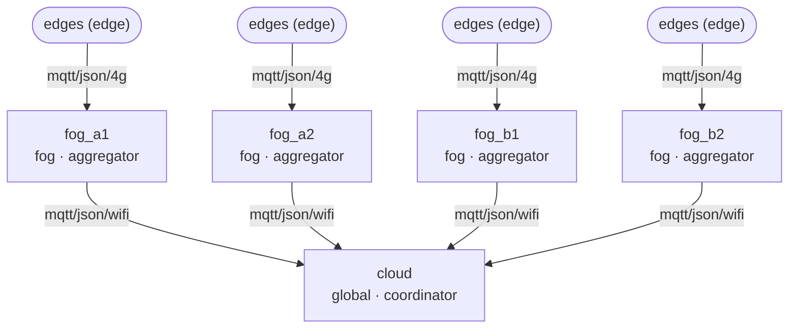

# Onion-FL

A framework to experiment with hierarchical federated learning (edge → fog → … → cloud): trees of any depth, fogs that mix datasets, pluggable learning techniques, a virtual-clock simulator and real runs over MQTT, with every level instrumented. It grew out of a stress-detection project on wearable and workplace data (SWELL, SWEET, WESAD) and is a master's thesis (TFM) prototype.

[](https://github.com/adrianoggm/Onion-FL/actions/workflows/ci.yml)


> **About this README.** It describes the redesigned framework as of v0.4.0 (October 2026), which adds federated learning techniques (personalisation, drift correction, robust aggregation and privacy, server optimizers and buffering) to the Onion-FL Studio of v0.3.0 and the framework of v0.2.0. Every number in it comes from a file in the repository, cited next to it. The datasets are not in git. SWELL-KW and WESAD were downloaded and checked against their descriptors in October 2026, and the first results of the new framework on real data are in [§7](#7-results). SWEET is still unchecked. [§1](#1-status) says exactly what is verified and how.

## Contents

1. [Status](#1-status)
2. [Quick start](#2-quick-start)
3. [How it works](#3-how-it-works)
4. [Experiments](#4-experiments)
5. [Datasets](#5-datasets)
6. [Observability](#6-observability)
7. [Results](#7-results)
8. [Repository map](#8-repository-map)
9. [Development and CI](#9-development-and-ci)
10. [Known limitations](#10-known-limitations)
11. [Roadmap](#11-roadmap)
12. [Project history](#12-project-history)
13. [License and acknowledgments](#13-license-and-acknowledgments)

---

## 1. Status

### At a glance

| Area | Status | Summary |
|---|---|---|
| Topologies | ✅ | Trees of any depth in YAML (compact or general form), each with a `topology_id` (SHA-256 of its structure and links) and a JSON/Mermaid graph |
| Data | ✅ / ⚠️ | Declarative ingestion (readers and steps), a signed cache, subject roles fixed across scenarios, and placement plugins. FEMNIST (LEAF, one subject per writer, 200 fixed writers) adds a dataset with hundreds of natural clients, Fed-Heart-Disease (FLamby, four hospitals with their official test splits) a cross-silo one, and CIFAR-10 one with synthetic clients (`iid`, Dir(α) or k classes each, as NIID-Bench) and its official test batch. The SWELL, WESAD, Stress-Predict, FEMNIST and Fed-Heart-Disease descriptors are checked against the published files (and against the loaders from before the redesign, or FLamby's code for Fed-Heart-Disease); **SWEET is not** ([§5](#5-datasets)) |
| Learning | ✅ | Two model families with the same namespaced parts (adapter per dataset, shared or per-dataset trunk, head per task or dataset): `modular_mlp` and `feature_transformer` (one token per feature, attention trunk). Sharing scopes: global, per level, local. Per-key aggregators and server optimizers; trainers `standard`, `fedprox`; for personalisation `ditto`, `apfl`, `fedrep`, `fedbabu` and the `lg_fedavg` sharing preset; for non-IID drift `scaffold`, `moon`, and the trainer + server optimizer pairs `fednova` and `feddyn`. Algorithms exchange extra state (control variates) as auxiliary arrays, and the server optimizer gets each round's statistics (steps, edges). Robust aggregators (`krum`, `multi_krum`, `bulyan`, `geometric_median`, `norm_clip`), central and local differential privacy (`dp_fedavg`, `local_dp`) with ε per round, and an attack axis (`label_flip`, `sign_flip`, `gaussian`, `scale`) on a seeded fraction of edges. Edges also score personal and fine-tuned models; random or checkpoint init |
| Round protocol | ✅ | Coordinator, aggregators at any level, edges and evaluators. Registration with acknowledged `hello`, quorum and deadline, staleness and participation plugins, per-key weights, evaluation at edge, zone and global level |
| Simulation | ✅ | Virtual clock; links with latency, jitter, bandwidth and loss; compute and availability models; deterministic for a seed |
| Real runs | ✅ | One process per aggregator over MQTT; a manual `onion_fl node` start for several machines. Verified locally against Mosquitto: 3 processes, every message delivered, latencies measured, and the same final model as the simulation |
| Observability | ✅ | `runs/<run_id>/` with signed events, summary and final model. Diagnostics at every aggregator; analysis API with mean ± CI over seeds; HTML report; Prometheus and OpenTelemetry sinks; Grafana dashboard |
| CLI | ✅ | `onion_fl data · topology · plan · run · node · ceiling · fidelity · calibrate · report · baseline · schema · serve` |
| Studio | ✅ | `onion_fl serve`: the topology library and editor; experiments with their plan and launch; a live run monitor; comparisons between topologies and scenarios per level; and a tutorial with dry-run previews ([§6](#6-observability)) |
| Continual learning | ✅ / ⚠️ | Every simulated run writes a signed bundle, and a later run continues it exactly (`init: run`). Edges can be fed by streams: rows in time order, a labelled fraction, delayed labels, test-then-train scoring, a replay memory (`none`, `fifo`, `reservoir`, `class_balanced`), and objectives on the rows still waiting for their label (`pseudo_label`, `consistency`), with an audit of every pseudo-label. Triggers open the rounds (`schedule`, `volume`, `drift`, `any`), with drift detected per edge, zone and federation. A promotion policy keeps each round's model as a challenger until the validation streams promote it, with rollback. Each stream edge updates `warm`, `frozen` or `scratch`, the baselines of the continual benchmark, and `scripts/continuum_benchmark.py` measures it. Streams and continual runs also run on real processes; on the `distributed` backend each edge keeps its state on its machine and resumes it when its host restarts, and hosts may join late (C9, so far on containers acting as machines). The Studio shows the versions and their lineage, and its signed controls pause, resume, promote and roll back a live simulation. |
| gRPC and Flower transports, distributed deployment | ❌ | Planned: gRPC [#196](https://github.com/adrianoggm/Onion-FL/issues/196), Flower [#204](https://github.com/adrianoggm/Onion-FL/issues/204), distributed backend [#199](https://github.com/adrianoggm/Onion-FL/issues/199) (they replace E5 #104 and E6 #105) |
| Tests | ✅ | 1978 tests. With the datasets in `data/`, a local broker and Docker, 1970 pass and 8 skip: SWEET (2), the optional Parquet reader and the container runs of the emulated and distributed backends (5), which need the emulated host image. The CI starts a broker but has no data, so the data-dependent tests skip there |

### What the results can and can't support today

- **Eighteen experiments of the new framework have run on real data**, all committed in [§7](#7-results). They are the SWELL reference run, a SWELL + WESAD mixing sweep, the comparisons of personalisation, drift, robustness, privacy and server-side techniques, the comparison of two model families, the continuation of a trained model, two stream replays of SWELL + WESAD (without and with a replay memory), the triggers on those streams, the selection of the unlabelled objectives (a null result: nothing could be chosen), the continual benchmark (five baselines chosen on validation, then run on test, with sweeps and a promotion run), a FedAvg reference on 200 FEMNIST writers, FLamby's triangle on Fed-Heart-Disease, FedAvg with an MLP on CIFAR-10 (Dir(0.5) and IID; the NIID-Bench CNN reproduction waits for #245), and the same federation over four simulated architectures of the continuum. Most have three seeds (Fed-Heart-Disease and the architectures have five, and the architectures' times come from an uncalibrated infrastructure), so many intervals overlap. A pre-registered pilot on FEMNIST (`sim`, 390 runs) tests whether the factorised predictor picks the wrong federation when a deadline couples participation and data weight.
  - The reference run and the mixing sweep have no strong result. On SWELL, no model beats always predicting "stress" on the held-out subjects. On WESAD, the federated model reaches 0.77 accuracy where centralised logistic regression reaches 0.91.
  - In the technique comparisons, the clearest effects are on WESAD: FedDyn and SCAFFOLD beat FedAvg under drift, the adaptive server optimizers beat it too, and a strong sign-flip attack collapses FedAvg while norm clipping holds.
  - On the streams, no continual baseline learns to tell the classes apart on held-out subjects: every model that keeps updating ends predicting one class. The baselines differ only in how fast they follow the class that is arriving, and replay and the unlabelled rows add nothing measurable at a tenth of the labels.
- **The multi-dataset stress benchmark** (onion-bench-stress, [§7](#7-results)) ran on four E4 studies plus SWELL + WESAD with five seeds. Plain FedAvg beats the centralised logistic regression on no E4 study; FedBABU and FedDyn beat it on Stress-Predict and narrowly on PhysioNet; on Nurse Stress nothing is far from the majority class, and a model trained only on the laboratory studies transfers poorly to the hospital.
- **Checking the data found real problems,** now fixed. 999 means "missing" in the SWELL physiology file, for 53% of the heart-rate values, and both the old and the new loaders read it as a value. The facial and physiology joins and the WESAD chest signals `Resp` and `Temp` failed to load. The SWELL posture file has every date a month early, so posture is left out.
- **Tests that need data** skip without `data/` ([docs/RULES.md](docs/RULES.md)). Protocol tests use a stub trainer that learns nothing.
- **Legacy numbers stay legacy.** [§7](#7-results) lists the baselines from before the redesign with their caveats. Some of them predate the `blok` leak fix.
- **The real-data-only rule holds.** Two old preprocessing scripts once wrote `np.random` values under the real SWELL file names. Both are deleted; if either ran on your machine, restore `data/SWELL/` from the original download. The dataset card (`onion_fl data inspect`) flags any feature whose correlation with the label is above 0.95.

---

## 2. Quick start

### Install

Python 3.11. The repository uses a `.venv` created with [uv](https://docs.astral.sh/uv/):

```bash
uv venv .venv --python 3.11
uv pip install --python .venv torch --index-url https://download.pytorch.org/whl/cpu
uv pip install --python .venv -e ".[dev]"        # add ",analysis" for XGBoost
```

Or run `just install-dev`. The command line is `onion_fl` (also `python -m onion_fl`).

### Put the data in place

The data is not in git. Download each dataset from its source and place it where its descriptor in `datasets/` expects it:

| Dataset | Source | Path | Descriptor |
|---|---|---|---|
| SWELL-KW | [DANS](https://doi.org/10.17026/dans-x55-69zp), open access: the 11 files of `3 - Feature dataset/per sensor` (18 MB; download the two `.tab` files in their original format, CSV) | `data/SWELL/3 - Feature dataset/per sensor/` | `datasets/swell.yaml` (computer file; facial and physiology as options), `datasets/swell_physiology.yaml` |
| SWEET | — | `data/SWEET/{sample_subjects,selection1/users,selection2/users}/<user>/` | `datasets/sweet.yaml` |
| WESAD | [University of Siegen](https://uni-siegen.sciebo.de/s/HGdUkoNlW1Ub0Gx) (`WESAD.zip`, 2.2 GB; publications must cite Schmidt et al., 2018); extract the `S<n>/S<n>.pkl` files (13 GB) into `data/` | `data/WESAD/S<n>/S<n>.pkl` | `datasets/wesad.yaml`, `datasets/wesad_e4.yaml` (wrist at the native E4 rates, with the harmonized E4 features) |
| PhysioNet Wearable Device | [PhysioNet](https://physionet.org/content/wearable-device-dataset/1.0.1/) ("Wearable Device Dataset from Induced Stress and Structured Exercise Sessions", v1.0.1, ODC-By 1.0, open access; cite the dataset and PhysioNet): the official zip (`wearable-device-dataset-1.0.1.zip`, 73 MB; 259 MB extracted), checked against the project's `SHA256SUMS.txt`, or `wget -r -N -c -np https://physionet.org/files/wearable-device-dataset/1.0.1/`. Extract the contents of its top folder into `data/PhysioNetE4/` | `data/PhysioNetE4/Wearable_Dataset/{STRESS,AEROBIC,ANAEROBIC}/<session>/*.csv` | `datasets/physionet_e4.yaml` (Empatica E4 at native rates, harmonized E4 features; one subject per participant) |
| Nurse Stress | [Dryad](https://doi.org/10.5061/dryad.5hqbzkh6f) or the same files on [Zenodo](https://zenodo.org/records/5514277) (Hosseini et al., 2022, *Sci. Data* 9:255), **CC0**: redistributable, so a real extract may be shared. Download `Stress_dataset.zip` (1.16 GB, MD5 `8829a9c0…210cea`) and `SurveyResults.xlsx`; the zip holds one zip per E4 session, which `python -I scripts/nurse_stress_extract.py data/NurseStress/Stress_dataset.zip data/NurseStress/Stress_dataset` unpacks (3.6 GB, 609 sessions). Reading the survey needs openpyxl (extra `excel`). `scripts/nurse_stress_sample.py` writes a 9 MB real extract (four sessions of four nurses) to `data/samples/NurseStress/` | `data/NurseStress/{SurveyResults.xlsx,Stress_dataset/<ID>/<ID>_<start>/}` | `datasets/nurse_stress.yaml` (survey events on E4 windows; the time zone and the labels are in its header) |
| Stress-Predict | [GitHub](https://github.com/italha-d/Stress-Predict-Dataset) (MIT; cite Iqbal et al., 2022, *Sensors* 22:8135): download the repository archive (`Download ZIP`, 24 MB) and extract its folders; reading `Time_logs.xlsx` needs openpyxl (in the `dev` extra). `scripts/stress_predict_sample.py` copies three sessions, with the licence, into `data/samples/stress_predict/` for the tests | `data/StressPredict/{Raw_data/S<n>/*.csv,Processed_data/Time_logs.xlsx}` | `datasets/stress_predict.yaml` (34 subjects, harmonized E4 features) |
| FEMNIST | [LEAF](https://github.com/TalwalkarLab/leaf) (Caldas et al., 2018; BSD-2): `./preprocess.sh` in `leaf/data/femnist` downloads NIST SD19 and first writes `data/all_data/all_data_<k>.json`, every writer before LEAF's sampling (about 3,600); copy those files. A shorter route is the Flower Datasets copy, [flwrlabs/femnist](https://huggingface.co/datasets/flwrlabs/femnist) (one 201 MB Parquet file): `scripts/femnist_from_flower.py` writes the 200 declared writers in the same format (it needs pyarrow and Pillow, not dependencies of Onion-FL; the command is in the script) | `data/FEMNIST/all_data/*.json` | `datasets/femnist.yaml` (200 fixed writers) |
| Fed-Heart-Disease | [UCI Heart Disease](https://archive.ics.uci.edu/dataset/45/heart+disease) (Janosi et al., 1988; CC BY 4.0, doi:10.24432/C52P4X), the four files FLamby's `download.py` fetches: `processed.{cleveland,hungarian,switzerland,va}.data` from `https://archive.ics.uci.edu/ml/machine-learning-databases/heart-disease/` (40 KB) into `data/HeartDisease/raw/`. `scripts/heart_disease_flamby.py` checks FLamby's MD5 sums and writes FLamby's preprocessing and train/test split, one CSV per center and split (the command is in the script) | `data/HeartDisease/flamby/<center>{,_test}.csv` | `datasets/heart_disease.yaml` (4 hospitals, FLamby's split) |
| CIFAR-10 | [University of Toronto](https://www.cs.toronto.edu/~kriz/cifar.html), the python version (`cifar-10-python.tar.gz`, 163 MB, MD5 `c58f30108f718f92721af3b95e74349a`). The page gives no licence; it asks that work using the dataset cite Krizhevsky (2009), *Learning Multiple Layers of Features from Tiny Images*. Check the MD5 and extract it into `data/CIFAR10/`. The batches are pickles: the reader opens them with a restricted unpickler that runs no code from the file | `data/CIFAR10/cifar-10-batches-py/{data_batch_1..5,test_batch}` | `datasets/cifar10.yaml` (synthetic clients) |

FedScale's client device traces (issue #253; [FedScale](https://github.com/SymbioticLab/FedScale), Apache-2.0) are infrastructure, not data to learn from. Download `client_device_capacity` and `client_behave_trace` from [`benchmark/dataset/data/device_info/`](https://github.com/SymbioticLab/FedScale/tree/7ec441c2afa99510535adebe155d89fa8bb2c637/benchmark/dataset/data/device_info) (65 MB) into `data/FedScale/` and run `onion_fl traces import fedscale data/FedScale`. They are pickles: the import reads them with an unpickler that builds only plain values and writes `capacity.csv`, `behaviour.jsonl` and `manifest.json`, which is all the runs read. `infrastructures/fedscale_field.yaml` samples its phones from them.

### Run

```bash
onion_fl data inspect swell                   # dataset card: subjects, classes, missing values, leak warnings
onion_fl topology show topologies/four_fogs.yaml
onion_fl plan experiments/mix_ab.yaml         # composition per fog and groups per link, no training
onion_fl run experiments/mix_ab.yaml --workers 3
onion_fl report experiments/mix_ab.yaml --by topology_id --by scenario
onion_fl baseline experiments/mix_ab.yaml     # LR, RF, XGBoost on the same test subjects
onion_fl baseline experiments/mix_ab.yaml --seeds 0 1 2   # each seed draws other test subjects; mean and 95% CI
onion_fl explain runs/<run_id>                # feature importance on val subjects
```

For a real run over MQTT, start the stack (`just docker-up`, [docker/README.md](docker/README.md)), point the links at the broker and run `onion_fl run <experiment> --backend local` (`--mode real` is its alias). Links with `transport: grpc` need no broker (`uv pip install -e ".[grpc]"`, already in dev), and neither do links with `transport: flower`, which carry each frame as a Flower message (`uv pip install -e ".[flower]"`, Flower >= 1.21; not in dev).
With Docker, `--backend emulated` runs the same processes in one container per host of the experiment's `infrastructure`, with its CPU and memory limits and its links emulated by netem ([docs/architecture.md](docs/architecture.md), §7). The first run builds the host image, which takes a few minutes.
On real machines, `--backend distributed` with an inventory of them (SSH address, user and key path) checks each one first (the same `onion_fl` source, the data, the clock against the launcher or NTP, the broker and the gRPC ports), starts one process per host over SSH and brings the events back ([docs/architecture.md](docs/architecture.md), §7; hardware still pending: [docs/distributed-hardware.md](docs/distributed-hardware.md)).

The simulation's compute rates and links can come from measurements: `onion_fl calibrate measure <spec>` runs microbenchmarks (training per profile and model, aggregation, MQTT paths) in that emulation, `calibrate fit` turns several sessions into a signed `calibrations/<calibration_id>/` that profiles and links cite with `calibration: <id>`, each value with the 95 % interval one more session's value falls in, and `calibrate check` judges a session the fit never saw against it. A run whose rate for a model had to be estimated by FLOPs says so in `run.json` (`estimated`), as does one that sends past the sizes its calibrated paths hold (`outside_calibration`), and `onion_fl fidelity` refuses both ([docs/architecture.md](docs/architecture.md), §7a). The emulated lab's calibration `b55104b3…` ([results/calibration_emulated_pinned](results/calibration_emulated_pinned/INDEX.md)), fitted on four pinned sessions, passes every quantity on two check sessions of its day, and 49 of 54 per session three days later, when the machine computed about twice as fast; its compute intervals span a factor of 2.6 to 26, the network's a few tenths of a millisecond.

### Studio

```bash
uv pip install --python .venv -e ".[studio]"   # FastAPI and uvicorn (already in dev)
onion_fl serve                                  # http://127.0.0.1:8765
```

The Studio reads and writes the same files as the command line (`topologies/`, `experiments/`, `runs/`). It has five areas:
- **Topologies:** the library, the graph and an editor that validates as you type.
- **Experiments:** scenarios, the dry-run plan (composition per fog, groups per link, a stream's pace, warnings) and a launch button.
- **Runs:** status, identity, the rounds and their triggers, the drift detected, metrics per level and live events; with versions, their lineage and scores, the rows and drift per edge, and the operator's controls.
- **Compare:** mean ± CI over seeds, by topology, scenario or dataset.
- **Tutorial:** every plugin explained, with previews of sharing, placement and network profiles.

---

## 3. How it works

The full design is in [docs/architecture.md](docs/architecture.md), and how it compares with Flower, FedML, FedScale, Fogify, EmuFog, iFogSim and EdgeSimPy is in [docs/related-work.md](docs/related-work.md). In short:



*`topologies/four_fogs.yaml`, drawn with `onion_fl topology show --mermaid`; the graphs are in [docs/diagrams/](docs/diagrams/).*

| Layer | What it does |
|---|---|
| `core` | `Message` and codecs (`json`, `npz`), `Node` (a state machine) and `Context` (its only way out), topologies and identifiers, plugin registries |
| `data` | Descriptors → cache → `SubjectData` per subject → roles (test, val, train, local_val, clients, scaling fitted on train only) → placement under the leaf aggregators |
| `learning` | Modular model with namespaced keys (`adapter.<ds>`, `trunk`, `head.<task>`), sharing scopes, aggregators, server optimizers, trainers, inits, metrics |
| `roles` | Coordinator, aggregators and edges. Every round sends each link only the groups its scope lets through; weights travel per key, so a tree of FedAvg equals a flat FedAvg |
| `runtime` | `SimRuntime` (virtual clock) and `RealRuntime` (wall clock); both drive the same nodes |
| `transports` | `memory`, `mqtt` (one inbox per node, QoS and broker per link) `grpc` (direct links, no broker; `grpc` extra) and `flower` (the same links, each frame in a Flower message; `flower` extra) |
| `observability` | Events, run identity and signature, diagnostics, analysis, report, sinks |
| `experiment` | Config, sweeps, the dry-run plan, the runner and the CLI |

Every experimental axis is a plugin chosen by name in the config, and new ones are registered without touching the core: placement, transport, codec, aggregator, trainer, server optimizer, sharing, model, init, metric, diagnostic, participation, staleness and sink. `onion_fl schema` exports the config's JSON Schema with the catalogue of every plugin and its parameters.

---

## 4. Experiments

An experiment names a topology, the data, the learning setup, the rounds, the evaluation and the runtime, plus seeds and a sweep. `experiments/mix_ab.yaml` takes SWELL and SWEET over four fogs from segregated (α = 0) to fully mixed (α = 1):

```yaml
name: mix_ab
topology: four_fogs
data:
  datasets: {swell: {}, sweet: {options: {label: binary}}}
  roles: {test: 0.2, val: 0.1, local_val: 0.2, scaler: global, seed: 0}
  placement: {name: mixing, alpha: 0.0}
learning:
  model: {name: modular_mlp, adapter_width: 64, trunk_hidden: [64, 32]}
  sharing: fedavg
  trainer: {name: standard, local_epochs: 1, lr: 0.001}
rounds: 20
evaluation: {metrics: [loss, accuracy, macro_f1], edge: {every: 5}, aggregators: {every: 5}, global: {every: 1}}
seeds: [0, 1, 2]
sweep: {data.placement.alpha: [0.0, 0.5, 1.0]}
```

- **Scenarios.** Each combination of the swept values, times each seed, is one run. Its `config_id` hashes the validated config without the seed, so the seeds of a scenario group together.
- **Subject roles.** They use their own seed, so the test subjects are the same in every scenario and seed.
- **Validation.** Errors name their exact path, for example `learning.trainer: plugin 'standard': invalid parameters: lr …`.
- **Paired values.** A key `a,b` sweeps several paths together: `learning.sharing,learning.trainer.name: [[fedper, fedrep], [fedavg, ditto]]` gives one scenario per pair. A whole plugin can be a value; its scenario is named `name(k=v,…)`.
- **Random search.** `search: {budget: 16, seed: 0, space: {learning.trainer.lr: {low: 1.0e-4, high: 1.0e-1, log: true}, learning.trainer.local_epochs: [1, 2, 4]}}` turns each swept scenario into `budget` trials, drawn from the search's own seed; a path is either swept or searched. Each trial keeps the search seed and its index, so they are part of its `config_id`. Unset, it stays out of the `config_id`.
- **Noise ceiling.** `onion_fl ceiling <experiment> --replicas R` runs R replicas of every swept scenario, each with its own seed (`--paired` gives the scenarios of a replica the same seed), and with a search keeps each one's best trial (`--resample` also redraws the search per replica). It prints the top-1 agreement and the selection regret between replicas, with the agreement expected by chance (1/K). The score is the last `--metric` of the root, pooled over datasets unless `--series` picks one, and the trials are chosen on that score too: for a search, set `evaluation.global.subjects: val`.
- **Fidelity.** `onion_fl fidelity <runs A> <runs B>` compares the runs of a backend under test (B, for example `sim`) with those of a reference (A, for example `local`) on the same experiment, pairing them by configuration and seed. It reports functional fidelity (final model, protocol events per node, bytes per link), the relative error of round, compute and link times with bootstrap intervals, and decision fidelity per `--metric` (Kendall's τ-b, top-1 agreement, selection regret, the probability of top-1 agreement from a bootstrap paired by seed), each next to the noise ceiling (`--ceiling` with the output of `onion_fl ceiling`, or the seeds of A). On `time` and `time_to_target` it also shows how the factorised predictor (rounds to target in a synchronous control run × time per round from the compute and network models, plain and with a FLOSS-style participation correction) decides against A; `onion_fl fidelity predictor <runs>` makes the predictor a side itself, and `--control` names the control runs. It warns when every configuration ties on a metric. `--csv` and `--html` write the report.
- **Aggregator, attack and privacy.** `learning.aggregator` sets the aggregator of the leaf aggregators (the fogs over the edges). `attack` makes a seeded fraction of each dataset's edges malicious, and `privacy` adds local DP at every edge. Unset, they stay out of the `config_id`.
- **Server optimizer.** `learning.server_optimizer` sets the root's optimizer. Pairs such as `scaffold`, `fednova` and `feddyn` are checked against the trainer before the first scenario runs.
- **Buffering and selection.**
  - `close_at_quorum: true` on an aggregator closes its round as soon as its `quorum` is in, late updates included. With `staleness: next_round` this gives hierarchical buffering inspired by FedBuff (`experiments/fedbuff.yaml`); the cloud stays synchronous.
  - `evaluation.global.subjects: val` scores the global model on the validation subjects instead of the test ones, for choosing server-side hyperparameters.
- **Continuing a run.** `learning.init: {name: run, run: <run_id> | experiment:<name>[/<scenario>], restore: {...}}` continues a finished, signed run from its bundle (`runs/<run_id>/bundle/`): global model, server state, edges, random streams and frozen preprocessing; the round numbering goes on and the parent is recorded in `run.json`. A continuation that cannot be exact is refused.
- **Streams.** `stream: {bootstrap, round_every, batch_size, speed, start}` and `labels: {fraction, delay}` replay each training subject's rows to its edge in time order.
  - The bootstrap (the first minutes, or rows) is history: it fits the preprocessing and trains v0.
  - A seeded fraction of the rows is labelled, each label arriving after the delay.
  - Every arrival is scored by the model the edge was serving before it can train (`prequential` and `prequential_labelled`), and each round trains on what became trainable since the edge's previous round.
  - Validation subjects stream for evaluation only; test subjects never reach an edge.
  - Rounds come every `round_every` of data time until the streams end, or when a trigger fires (below), and `data.arrived` and `data.labelled` record the volume.
  - Real mode, `init: run`, `local_val`, a local scaler and participation other than `all` are refused with a stream for now.
- **Replay.** `continual: {memory: {name: reservoir, capacity: 512}, replay_ratio: 0.5}` gives every streaming edge a memory of rows it already trained on.
  - Each training adds a sample from the memory to its new rows, so that a fraction `replay_ratio` of it is replayed.
  - A row enters the memory only after its first successful training. The edge is still weighted by its new rows, and `memory: none` runs exactly as without `continual`.
- **Unlabelled rows.** `unlabelled: {name: pseudo_label, threshold: 0.9, weight: 0.5}` (or `{name: consistency, noise: 0.1}`) lets every streaming edge learn from the rows whose label has not arrived.
  - The objective sees their features only, with the model as received, and adds a weighted term to each labelled batch. An edge with no new labelled rows stays idle.
  - `diagnostic.unlabelled` reports the rows seen and accepted, the confidence and, in simulation, the accuracy of the pseudo-labels; the bundle keeps each one's class, confidence and the round whose model generated it.
  - Ditto, APFL and FedRep are refused (their own loops add no term), and so is `unlabelled` without a stream.
- **Triggers.** `continual.trigger` replaces `stream.round_every`:

  ```yaml
  continual:
    trigger: {name: any, of: [{name: schedule, every: 30m}, {name: drift, kind: prior}]}
    edge_trigger: {name: volume, samples: 64}   # an edge trains once it has 64 new rows
    status_every: 5m
  ```

  - Edges report what became trainable and their drift statistics every `status_every`, without data. The fogs pool them, and the coordinator opens a round when its trigger fires, counting what was reported after the current round reached each edge.
  - The local trigger never holds back an edge's first model (v0) or its rounds after its last label.
  - Drift (`data`, `prior` or `performance`) is detected per edge, per zone and for the federation, and reported as `drift.detected`. `trigger.fired` names what opened each round.
  - A schedule must be a multiple of `status_every`. One whose `every` and `status_every` equal the old `round_every` gives C3's model, as long as each round closes within its period.
  - `run.finished` says whether the last label (`horizon`) or the `rounds` cap ended the run.
  - Before M1 ([#193](https://github.com/adrianoggm/Onion-FL/issues/193)) the triggers were a `continuum` block of their own. It still loads for one version, with a deprecation warning, and gives the same `config_id`: the committed experiments keep it, so their scenarios keep their names. The package `onion_fl.continuum` is now `onion_fl.continual`, with the old name as an alias.
- **Champion and challenger.** `promotion` keeps each round's model as a challenger until the validation streams decide on it:

  ```yaml
  promotion: {name: champion_challenger, metric: macro_f1, min_delta: -0.01, max_forgetting: 0.03, min_samples: 500}
  ```

  - The edges serve the champion only. A validator per validation subject, under the root, scores both on the labels that came since the champion was promoted (or within `window`), and on every earlier one, the history included.
  - The challenger is promoted unless it loses more than `min_delta` on the recent window, forgets more than `max_forgetting` on the earlier labels, or has fewer than `min_samples` recent labels to be judged. A rejection leaves the champion and its server state as they were. The test subjects never decide.
  - `version.candidate`, `version.promoted`, `version.rejected` and `version.rollback` carry the decision's scores. An operator's control message to the coordinator (`{rollback: v}`, `null` for the previous champion, or `{promote: v}`) changes the champion. Only the configured operator ids may send it, and only the configured validators decide; a missing or non-finite score never promotes.
  - **Operators.** A YAML file of operator ids and tokens (`alice: <16 characters or more>`), named by `ONIONFL_OPERATORS` or `onion_fl serve --operators`, says who may give orders. Each order is signed for its run with the operator's token, and the coordinator refuses an unsigned, forged or replayed one on any transport. Without the file, no order is taken.
  - **Live control.** A simulation with operators reads its inbox as it runs: in the Studio, a run's page pauses and resumes it, and promotes or rolls back a version, at once or at a virtual time. `onion_fl run --paused` (or "en pausa" in the Studio) starts it paused. The same controls are an HTTP API:

    ```bash
    curl -X POST localhost:8765/api/runs/<run_id>/control -H "Authorization: Bearer $TOKEN" \
         -H "Content-Type: application/json" -d '{"order": "rollback", "at": 12}'
    ```
  - The bundle's model is the champion, and its lineage lists every version.
- **Edge validation.** `data.roles.local_val_split: class_tail` holds out the last rows of each class instead of the last rows of the recording, which are usually a single condition.
- **Downloadable data.** `experiments/mix_swell_wesad.yaml` runs the same sweep with SWELL and WESAD, the two datasets that can be downloaded. It trains for 10 local epochs: with one, the model only learns the majority class ([§7](#7-results)).

Each run writes `runs/<run_id>/`:

| File | Content |
|---|---|
| `run.json` | Identifiers (`topology_id`, `config_id`, `data_id`, `code_version`), resolved config, host, start and end, status (`running`, `finished`, `incomplete`, `failed`), the ex ante diagnostic of the deadline bias (`diagnostic`, in `sim`) and `run_hash` |
| `events.jsonl` | Every event: messages, rounds, training, evaluation, diagnostics, data composition |
| `summary.json` | Rounds, traffic, failures and the last scores at the root |
| `model.npz` | The final global model, loadable as a `checkpoint` init |

`run_id` is `<UTC date>-<sha12>`, unique even when the same config runs in parallel. `run_hash` covers `run.json`, the events, the summary and the model, so any later change is detected (`verify_run`). A result is cited with `topology_id` + `config_id` + `run_id` + `run_hash`.

---

## 5. Datasets

| Dataset | Label strategies | Unit | Notes |
|---|---|---|---|
| **SWELL-KW** | `binary` (N vs T, I, R), `binary_no_r` | One row per minute and subject | The computer file by default; facial and physiology are optional joins (posture is left out: its file has every date a month early). 999 is missing in facial and physiology. `swell_physiology.yaml` is physiology only |
| **SWEET** | `binary` (stress ≥ 2), `ordinal` (1–5), `three_class` | One self-report matched to the feature minute | `selection` option: `sample_subjects`, `selection1/users`, `selection2/users`; subjects with fewer than 5 samples are dropped |
| **WESAD** | `binary` (baseline vs stress), `three_class` (+ amusement) | 60 s windows, 50% overlap, five statistics per channel | `location`: wrist (default) or chest; `signals` option |
| **PhysioNet Wearable Device** | `binary` (baseline and rests vs stress tasks, task `stress_binary`), `three_class` (+ exercise, task `stress_vs_exercise`) | 60 s windows, 50% overlap, five statistics per E4 channel | Labels from the protocol tags; the sessions that `data_constraints.txt` flags as invalid, incomplete or split are dropped or cut, as the descriptor documents. The 30 s stages give no 60 s windows (`window_seconds` option) |
| **Nurse Stress** | `binary` (inside a survey event rated ≥ 1 vs outside every event of a surveyed E4 session), `high` (rated 2) | 60 s windows, 50% overlap, the harmonized E4 features (ACC, BVP, EDA, TEMP at native rates) | One subject per nurse (15), never the session; windows in unrated or level-0 events, and sessions without an event, are dropped. Survey times are local (America/Chicago, with daylight saving), the E4 is Unix UTC. The events were flagged by the authors' detector on EDA, HR and TEMP, so "no stress" is partly what it did not flag. 63,913 windows, 15% stress |
| **Stress-Predict** | `stress_binary` (Stroop, interview and hyperventilation vs baseline, rests and questionnaire) | 60 s windows, 50% overlap, the harmonized E4 features | Labels from `Time_logs.xlsx` (minute resolution): they agree with the authors' processed CSV on 96.3% of its seconds ([INDEX](results/stress_predict_reference/INDEX.md)). S01 is left out, as by the authors; consent and the gaps between phases have no class |
| **FEMNIST** | `character` (62 classes: 0-9, A-Z, a-z) | One 28x28 image per row, 784 pixels in [0, 1] | One subject per writer: a fixed subsample of 200 writers (44,451 images) declared in the descriptor; the writer id is never a feature |
| **Fed-Heart-Disease** | `heart_disease` (no disease vs disease, UCI `num` ≥ 1) | One patient per row, FLamby's 13 features | Cross-silo: one subject per hospital and split (`cleveland` and `cleveland_test`, …), FLamby's fixed split (train/test 199/104, 172/89, 30/16 and 85/45). The `*_test` subjects are the test role (docs/RULES.md §2); the center is never a feature |
| **CIFAR-10** | `object` (10 classes) | One 32x32 colour image per row, 3,072 pixels in [0, 1] | No natural clients: the `partition` step cuts the 50,000 training images into synthetic clients (`iid`, `dirichlet_label` with `alpha`, or `label_skew` with `k` classes each, as NIID-Bench), drawn from the labels and `partition_seed` only. The official test batch is the subject `test`, reserved with `data.roles.overrides.cifar10.test: [test]` (`experiments/cifar10_mlp.yaml`) |

Missing values stay missing in the cache. Imputation, scaling and the removal of constant features are fitted on the training subjects only. A dataset can set its own in `data.roles.overrides`, for example `femnist: {scaler: none, drop_constant: false}` to keep the raw pixels (`experiments/mix_swell_femnist.yaml`). A descriptor whose features are token indices declares `tokens: true`, and an experiment that would scale it is refused. The descriptors record in their comments what was found in the published files, for example the keys that join the SWELL modalities. `tests/test_datasets_descriptors.py` compares each descriptor with the loader from before the redesign, and it runs as soon as `data/` is present. It passes for SWELL (computer file) and WESAD (chest, subject S2).

---

## 6. Observability

Every runtime event is enriched into one schema and written to `events.jsonl`, the source of truth:

```
{t_virtual, t_wall, run_id, topology_id, scenario, seed, round, level, node, role, kind, name, value, tags}
```

- **Evaluation.**
  - Edges score the received and the trained model on their `local_val`.
  - Aggregators combine their children's scores by samples, and score the zone model on their `val` evaluators.
  - The coordinator scores the global model on the `test` evaluators, per dataset.
- **Diagnostics at every aggregator.**
  - Divergence: the cosine and L2 dispersion of the children's updates per parameter group.
  - Conflict between datasets: the cosine of their mean updates in the shared groups.
  - Drift across rounds, participation (with late updates and time to quorum) and fairness of the edge scores per dataset.
  - Traffic per link and round, which the run recorder adds.
- **Analysis.** `load_runs("runs/").compare(level="fog", metric="accuracy", by=["topology_id"])` gives the mean ± 95% CI over seeds per round, plus the spread across the nodes of the level. The runs of a group are pooled, so for a sweep over one topology add `scenario` or `config_id` to `by`. `onion_fl report` builds an HTML page from it. With `target=0.8`, `compare` gives the time to target instead: the mean first instant the metric reaches it, with a bootstrap interval, and how many runs never did (censored at their duration); `time_to_target` has the per-run rows.
- **Studio.** `onion_fl serve` gives the same views in the browser, and follows running runs live.
- **Live.**
  - The `prometheus` sink serves `onionfl_*` series on port 9464 for the Grafana dashboard. One server per process holds the runs of a sweep, told apart by `run_id`, so it needs `--workers 1`. With versions and streams it adds the champion, the version decisions and their scores, the rows arrived per edge and the drifts detected, in the dashboard's Continuum row.
  - The `otel` sink creates one span per send and per receive, linked by the message id. It exports them to the collector of the Docker stack.
  - A real run feeds both when the launcher merges the node processes' events, once the run has ended.

---

## 7. Results

**Only results backed by a committed file are listed.**

### New framework: the SWELL reference run

Source: [results/swell_reference/](results/swell_reference/INDEX.md), `config_id` `dbf79b91…`, `topology_id` `38ee627b…`, commit `1696c05`. It is `experiments/swell_reference.yaml`: physiology only, three fogs, 18 training subjects and 5 held-out test subjects (646 minutes, 67.3% stress), 12 rounds, seeds 0–9.

| Model | Accuracy | Macro-F1 | Balanced accuracy |
|---|---|---|---|
| Federated MLP (mean ± 95% CI over 10 seeds) | 0.669 ± 0.009 | 0.489 ± 0.011 | — |
| Centralised logistic regression | 0.689 | 0.463 | 0.527 |
| Centralised random forest | 0.613 | 0.495 | 0.506 |
| Always "stress" | 0.673 | 0.402 | 0.500 |

No model beats the majority class on these subjects. Per-minute physiology barely separates stress across unseen subjects, and heart rate is missing in 53% of the minutes. The pipeline works on real data; this is a weak signal, not a bug.

### New framework: SWELL and WESAD mixing sweep

Source: [results/mix_swell_wesad/](results/mix_swell_wesad/INDEX.md), `topology_id` `9033d1cf…`, commit `3d4db6f`. It is `experiments/mix_swell_wesad.yaml`: four fogs (two with SWELL as home, two with WESAD) on lossy links, a modular MLP with one adapter per dataset, 20 rounds, 3 seeds per α. Global model on the held-out subjects, mean ± 95% CI:

| α | SWELL macro-F1 | WESAD accuracy | WESAD macro-F1 |
|---|---|---|---|
| 0.0 (segregated) | 0.576 ± 0.048 | 0.775 ± 0.017 | 0.748 ± 0.021 |
| 0.5 | 0.578 ± 0.043 | 0.777 ± 0.008 | 0.750 ± 0.012 |
| 1.0 (mixed) | 0.584 ± 0.056 | 0.766 ± 0.030 | 0.736 ± 0.032 |

Placement has no measurable effect with three seeds. On the same subjects, centralised logistic regression gives WESAD 0.913 accuracy and 0.899 macro-F1, and the random forest gives SWELL 0.612 macro-F1. The lossy links cost the cloud 7–11 of its 20 rounds per run, which failed quorum.

### New framework: personalisation techniques

Source: [results/techniques_personalisation/](results/techniques_personalisation/INDEX.md), `topology_id` `9033d1cf…`, commit `5c2c121`. It is `experiments/techniques_personalisation.yaml`: SWELL + WESAD on four fogs at α = 0.5, 20 rounds, 3 seeds per technique. Macro-F1, mean ± 95% CI over the 3 seeds:
- **Global columns:** the global model on the test subjects.
- **Edge columns:** each edge's own held-out rows (the last 20% of each class) at round 20, from `edge_scores.csv`.

| Technique | Global SWELL | Global WESAD | Edge, trained | Edge, personal |
|---|---|---|---|---|
| FedAvg | 0.620 ± 0.012 | 0.746 ± 0.009 | 0.641 ± 0.023 | — |
| FedPer | ¹ | ¹ | 0.632 ± 0.033 | — |
| LG-FedAvg | ¹ | ¹ | 0.694 ± 0.007 | — |
| Ditto | 0.627 ± 0.011 | 0.746 ± 0.009 | 0.634 ± 0.013 | 0.651 ± 0.004 |
| APFL | 0.625 ± 0.006 | 0.747 ± 0.018 | 0.646 ± 0.024 | 0.695 ± 0.019 |
| FedRep | ¹ | ¹ | 0.621 ± 0.021 | — |
| FedBABU | 0.610 ± 0.004 | 0.749 ± 0.009 | 0.629 ± 0.018 | — |

¹ These keep groups on the edge, so their global model is not a meaningful score; the INDEX lists the numbers.

- **Who wins on the edges.** APFL's personal model and LG-FedAvg are the only techniques whose edge intervals clear FedAvg's. Ditto's personal model falls in between.
- **The global model is not hurt.** Ditto, APFL and FedBABU keep it as good as FedAvg's.
- **Edge scores are optimistic.** The held-out rows are close in time to the training rows, so the edge scores are optimistic for every technique alike. They rank the techniques, but don't compare with the global test scores.

### New framework: non-IID drift techniques

Source: [results/techniques_drift/](results/techniques_drift/INDEX.md), `topology_id` `ff55fe4d…`, commit `90ef785`. It is `experiments/techniques_drift.yaml`: SWELL + WESAD on four fogs at α = 0 (segregated), over lossless links so that lost rounds do not mix with drift. Training is SGD, 20 rounds, 3 seeds. Every technique's learning rate (0.1 for all) was chosen on the validation subjects, never on the test ones (`validation.csv`). Macro-F1, mean ± 95% CI:

| Technique | Global SWELL | Global WESAD | Edge, trained | Trunk alignment |
|---|---|---|---|---|
| FedAvg | 0.549 ± 0.081 | 0.752 ± 0.005 | 0.581 ± 0.040 | 0.177 ± 0.073 |
| FedProx | 0.545 ± 0.095 | 0.750 ± 0.012 | 0.584 ± 0.042 | 0.177 ± 0.075 |
| SCAFFOLD | 0.487 ± 0.072 | 0.828 ± 0.027 | 0.559 ± 0.045 | 0.171 ± 0.024 |
| FedNova | 0.561 ± 0.085 | 0.754 ± 0.014 | 0.595 ± 0.056 | 0.151 ± 0.051 |
| FedDyn | 0.593 ± 0.056 | 0.876 ± 0.010 | 0.616 ± 0.046 | 0.055 ± 0.010 |
| MOON | 0.551 ± 0.078 | 0.754 ± 0.014 | 0.575 ± 0.049 | 0.170 ± 0.063 |

- **On WESAD, FedDyn and SCAFFOLD beat FedAvg in these runs**; the three intervals do not overlap.
- **On SWELL, no technique separates from FedAvg.**
- **Over lossy links ([techniques_drift_lossy/](results/techniques_drift_lossy/INDEX.md)) every technique loses, but not alike.** The cloud loses 7–11 of 20 rounds. FedNova and FedDyn hold best on SWELL (0.510 against 0.416 for FedAvg), and FedDyn loses most of its WESAD lead (0.775).

### New framework: robust aggregation under attack

Source: [results/techniques_robustness/](results/techniques_robustness/INDEX.md), `topology_id` `ff55fe4d…`, commit `30ea239`. It is `experiments/techniques_robustness.yaml`: SWELL + WESAD on four fogs at α = 0.5, over lossless links. Every fog runs the scenario's aggregator, and 20% of each dataset's edges flip the sign of their update, x − s·(y − x). Global macro-F1, mean ± 95% CI over 3 seeds:

| Fog aggregator | SWELL, no attack | SWELL, s = 5 | WESAD, no attack | WESAD, s = 5 |
|---|---|---|---|---|
| FedAvg | 0.578 ± 0.109 | 0.244 ± 0.000 | 0.751 ± 0.000 | 0.392 ± 0.000 |
| Trimmed mean (β = 0.2) | 0.584 ± 0.066 | 0.429 ± 0.266 | 0.751 ± 0.000 | 0.316 ± 0.515 |
| Median | 0.587 ± 0.036 | 0.571 ± 0.109 | 0.763 ± 0.069 | 0.450 ± 0.963 |
| Krum (f = 2) | 0.582 ± 0.036 | 0.549 ± 0.143 | 0.743 ± 0.021 | 0.486 ± 0.768 |
| Multi-Krum (f = 2) | 0.599 ± 0.064 | 0.564 ± 0.104 | 0.788 ± 0.099 | 0.445 ± 1.006 |
| Geometric median | 0.587 ± 0.062 | 0.569 ± 0.156 | 0.751 ± 0.000 | 0.648 ± 0.752 |
| Bulyan (f = 1) | 0.587 ± 0.043 | 0.503 ± 0.280 | 0.754 ± 0.014 | 0.213 ± 0.147 |
| Norm clip (1.0) | 0.589 ± 0.059 | 0.575 ± 0.132 | 0.751 ± 0.000 | 0.777 ± 0.127 |

- **The strong attack (s = 5) collapses FedAvg**, and the trimmed mean does not stop it.
- **In these runs, norm clipping is the most stable defence against the strong attack on both datasets.** It keeps SWELL near the clean scenario and avoids the WESAD degradation seen with the other robust aggregators.
- **The other robust aggregators hold SWELL, but their WESAD scores vary widely between seeds.** The half-widths near 1 are correct for 3 seeds that disagree; the INDEX gives the per-seed values.
- **Selection detects the strong attackers, though rescued keys let some back in.** Multi-Krum drops 75% of them from its selection and fully excludes 64%. Bulyan, which picks with Krum one at a time as in its paper, runs at f = 0 in the 6-edge fogs, about half its selections.

### New framework: differential privacy

Source: [results/techniques_privacy/](results/techniques_privacy/INDEX.md), commit `5995082`. It is `experiments/techniques_privacy.yaml`: central DP at the fogs and local DP at the edges, with C = 1.0, over lossless links. ε is for δ = 1e-5, an upper bound without subsampling amplification; local DP is accounted with sensitivity 2C:

| Scenario | SWELL | WESAD | ε after 20 rounds |
|---|---|---|---|
| FedAvg (no DP) | 0.578 ± 0.109 | 0.751 ± 0.000 | — |
| Central DP, σ = 0.5 | 0.582 ± 0.074 | 0.629 ± 0.147 | 82.9 |
| Central DP, σ = 1.0 | 0.449 ± 0.120 | 0.311 ± 0.084 | 30.8 |
| Local DP, σ = 0.5 | 0.480 ± 0.150 | 0.317 ± 0.080 | 245.9 |
| Local DP, σ = 1.0 | 0.424 ± 0.072 | 0.391 ± 0.314 | 82.9 |

ε describes the mechanism with C fixed; C was calibrated on the training data without privacy, so it is not an end-to-end guarantee (the INDEX gives the adjacency and denominator). In this configuration, stronger privacy costs a lot of utility, and local DP costs much more than central DP. At the higher noise levels some edges diverge and the cloud loses rounds (up to 18 of 20 with local DP at σ = 1.0).

### New framework: server optimizers and asynchrony

Source: [results/techniques_server/](results/techniques_server/INDEX.md), `topology_id` `ff55fe4d…`, commit `47c482f`. It is `experiments/techniques_server.yaml`: the drift comparison's setup (SWELL + WESAD, segregated, lossless links, SGD at lr 0.1, 20 rounds, 3 seeds) with a different server side. Each optimizer's server rate was chosen by the final global model on the validation subjects (`validation.csv`). Macro-F1, mean ± 95% CI:

| Server side | Global SWELL | Global WESAD | Simulated time (s) |
|---|---|---|---|
| FedAvg | 0.549 ± 0.081 | 0.752 ± 0.005 | 21 |
| FedAvgM | 0.506 ± 0.018 | 0.754 ± 0.014 | 21 |
| FedAdam | 0.612 ± 0.038 | 0.853 ± 0.079 | 21 |
| FedYogi | 0.602 ± 0.041 | 0.875 ± 0.076 | 21 |
| FedAdagrad | 0.627 ± 0.013 | 0.898 ± 0.045 | 21 |
| FedBuff-style buffering at the fogs | 0.417 ± 0.031 | 0.749 ± 0.045 | 12 |
| FedBuff-style + FedAsync mixing rule | 0.512 ± 0.186 | 0.751 ± 0.000 | 12 |

- **In these runs, FedAdagrad, FedYogi and FedAdam beat FedAvg on WESAD**; the intervals do not overlap. On SWELL they overlap.
- **FedBuff-style buffering finishes 20 rounds in 43% less simulated time**, but its per-round score on SWELL is lower; time-to-accuracy is not compared yet. It is a hierarchical adaptation (the fogs buffer, the cloud stays synchronous), not the FedBuff or FedAsync protocol.

### New framework: the same federation over four architectures

Source: [results/infrastructure_architectures/](results/infrastructure_architectures/INDEX.md), commit `2833a9c`, `infrastructure_id` `90b27e16…` (A–C) and `a28dd1a2…` (D). It is `experiments/infrastructure_architectures.yaml`: SWELL + WESAD, the same subjects, training (SGD at lr 0.1, chosen on validation) and 5 seeds on an illustrative, uncalibrated infrastructure, on the `sim` backend. A: the 28 edges straight under the cloud; B: four fogs on two fog servers; C: B with mixed devices; D: C with the SWELL fogs' server down from 30 to 60 s and `nearest_alive` failover. Mean ± 95% CI:

| Arm | Global SWELL | Global WESAD | Round time (s) | Run (s) | WAN (MB) |
|---|---|---|---|---|---|
| A, cloud-centralised | 0.551 ± 0.039 | 0.753 ± 0.013 | 5.48 | 109.8 | 198.4 |
| B, edge–fog–cloud | 0.552 ± 0.036 | 0.754 ± 0.012 | 1.88 | 37.7 | 28.6 |
| C, heterogeneous | 0.552 ± 0.036 | 0.754 ± 0.012 | 7.56 | 151.3 | 28.6 |
| D, dynamic | 0.544 ± 0.042 | 0.751 ± 0.014 | 7.72 | 339.1 ± 120 | 18.2 |

- **The architectures tie on learning** (B and C give the same model bit for bit), so they are ranked on system metrics only.
- **In this model of the continuum**, the fogs cut WAN traffic 7× and round time 2.9× against the centralised cloud, slow devices make every round wait (4× B's), and a fog failure costs a round deadline (120 or 300 s) although the failover moves its edges within 5 s.
- **Decision fidelity between `sim` and `local`** (the logical federations of A and B, commit `76d1bd8`, 5 seeds each): the final models, protocol events and bytes match bit for bit in all 10 pairs, so both backends rank A and B the same on learning (a tie, below the seeds' noise ceiling) and on traffic. They rank them in opposite order on time: the logical `sim` has no compute model and counts link hops, while `local` measures this machine's training, which B spreads over four processes. C and D wait for the emulated backend (I10). The `local` runs had first stalled on MQTT behind Docker Desktop's port forwarding, fixed by giving the transport one connection each way. The INDEX gives the details.
- **Sim against emulated, with a closed calibration** ([results/fidelity_sim_emulated/](results/fidelity_sim_emulated/INDEX.md), pre-registered, calibration `b55104b3…`, 6 configurations × 5 seeds on other topologies than the calibration's): the protocol matches in all 30 pairs, but the calibrated simulation is still 40–50 % too fast in round time and link latency. It still picks the emulation's best configuration on time, bytes and learning with zero regret, and ranks time with τ-b 0.87. Bytes and models differ only by floating point, yet beyond the pre-registered tolerances.

### New framework: two model families

Source: [results/model_families/](results/model_families/INDEX.md), `topology_id` `ff55fe4d…`, `config_id` `f81c7216…` (MLP) and `ab0cab7d…` (transformer), commit `5b658b0`. It is `experiments/model_families.yaml`: FedAvg's setup above, with `modular_mlp` against `feature_transformer` (one token per feature, one attention block). Each family's SGD rate was chosen on the validation subjects: 0.1 for the MLP, 0.3 for the transformer. Macro-F1, mean ± 95% CI over 3 seeds:

| Family | Parameters | Global SWELL | Global WESAD | Traffic per run |
|---|---|---|---|---|
| `modular_mlp` | 9,378 | 0.549 ± 0.081 | 0.752 ± 0.005 | 261 MB |
| `feature_transformer` | 3,778 | 0.534 ± 0.240 | 0.752 ± 0.014 | 105 MB |

- **The two families tie on this benchmark.** The transformer varies much more between seeds on SWELL (0.426 to 0.613).
- **The transformer sends 60% fewer bytes, but costs 2.7 times as much compute.** Only the learning rate was tuned per family.

### New framework: contribution scores under noisy edges

Source: [results/contribution_noise/](results/contribution_noise/INDEX.md), `topology_id` `ff55fe4d…`, commit `f257ac4`. It is `experiments/contribution_noise.yaml`: SWELL + WESAD on four fogs at α = 0.5, FedAvg, 10 rounds, 5 seeds; in each dataset a seeded 20% of the edges flip their labels or send Gaussian noise (σ = 0.01). The fogs' `contribution` diagnostic is compared against the known noisy edges: AUC = P(honest edge scores above a noisy one) within a fog and round, mean ± 95% CI over seeds.

| Noisy edges | Shapley AUC | Leave-one-out AUC |
|---|---|---|
| Gaussian noise | 0.772 ± 0.054 | 0.780 ± 0.052 |
| Label flipping | 0.697 ± 0.238 | 0.704 ± 0.240 |

- **Edges that send noise score below the honest ones in every seed.**
- **Flipped labels score lower on average, but one seed of five goes the other way** (AUC 0.43); the interval includes 0.5.
- **Permutation importance on the val subjects** (`onion_fl explain`) puts `snkeystrokes` first on SWELL and `bvp_0_median` far ahead on WESAD; the INDEX lists the caveats.

### New framework: continuing a trained model

Source: [results/continuum_warm_start/](results/continuum_warm_start/INDEX.md), commit `63b0e47`. A federation trained on SWELL only for 20 rounds is continued with SWELL + WESAD (`learning.init: {name: run}`): rounds 21–40, SWELL's frozen preprocessing, WESAD's adapter fresh. Global macro-F1, mean ± 95% CI over 3 seeds:

| Scenario | Global SWELL | Global WESAD | WESAD after 5 rounds |
|---|---|---|---|
| Parent (SWELL only, 20 rounds) | 0.464 ± 0.137 | — | — |
| Continued with WESAD (rounds 21–40) | 0.599 ± 0.041 | 0.751 ± 0.000 | 0.721 ± 0.068 |
| From scratch, 20 rounds | 0.549 ± 0.081 | 0.752 ± 0.005 | 0.326 ± 0.141 |
| From scratch, 40 rounds | 0.608 ± 0.058 | 0.769 ± 0.023 | 0.326 ± 0.141 |

- **In these runs the continuation does not forget SWELL** (+0.135 over its parent), and it learns WESAD much faster from the trained trunk.
- **Continuing is exact.** A 20-round run continued for 20 more rounds equals 40 rounds without stopping, bit for bit, in all three seeds.

### New framework: SWELL and WESAD as streams

Source: [results/continuum_stream/](results/continuum_stream/INDEX.md), commit `64e3587`. It is `experiments/stream_swell_wesad.yaml`:
- each training subject replays its rows in time order, after a 20-minute bootstrap;
- a round comes every 10 minutes of data, 18 in all, until the last label arrives;
- every label, or a seeded fifth of them, arrives 10 minutes late;
- each round trains only on the rows it has not used yet.

Macro-F1, mean ± 95% CI over 3 seeds:

| Labels | Prequential SWELL | Prequential WESAD | Test SWELL | Test WESAD |
|---|---|---|---|---|
| Every row | 0.783 ± 0.045 | 0.000 ± 0.000 | 0.404 ± 0.000 | 0.262 ± 0.000 |
| A fifth | 0.800 ± 0.037 | 0.000 ± 0.000 | 0.404 ± 0.000 | 0.262 ± 0.000 |

- **The stream mechanics hold on the real recordings:** every row arrives in order, no label trains before it arrives, and two runs of the same seed are identical.
- **This is not yet continual learning.**
  - After its bootstrap, every WESAD window is stress, which the served model never predicts before the sessions end.
  - SWELL's prequential score mostly measures persistence within its condition blocks.
  - With no replay memory, the final model predicts stress for every test row. Memory is C4.

### New framework: replay on the streams

Source: [results/continuum_replay/](results/continuum_replay/INDEX.md), commit `ae6566f` (rerun after the review of PR #172). The streams above, every row labelled, recent rows only against recent rows plus replay (a 512-row reservoir, `replay_ratio` 0.5, not tuned). Macro-F1, mean ± 95% CI over 3 seeds:

| Scenario | Prequential SWELL | Prequential WESAD | Test SWELL | Test WESAD |
|---|---|---|---|---|
| Recent only | 0.783 ± 0.045 | 0.000 ± 0.000 | 0.404 ± 0.000 | 0.262 ± 0.000 |
| Replay | 0.614 ± 0.085 | 0.000 ± 0.000 | 0.351 ± 0.229 | 0.305 ± 0.187 |

- **Replay does not help in this setup.**
  - It slows the switch after a SWELL condition change, which costs a prequential score that mostly measures persistence.
  - At the untuned lr 0.1, training on twice the rows makes SWELL edges diverge: 1, 69 and 3 failed trainings in the three seeds. With quorum 1.0, that costs the cloud 1, 5 and 3 rounds, and all three final global models diverge too.
  - Every final model, with or without replay, predicts a single class for every test row. The test scores are the final models', scored offline.
- **Recent only reproduces the stream runs above bit for bit.** The benchmark (C8) chooses the learning rate and replay settings on validation.

### New framework: triggers on the streams

Source: [results/continuum_triggers/](results/continuum_triggers/INDEX.md), commit `29bf949`. The streams above, every row labelled, no replay. A continuum trigger opens the rounds: a schedule every 10 minutes (C3's pace), 300 reported rows (volume), or a prior shift detected at an edge, a fog or the cloud (drift). Mean ± 95% CI over 3 seeds:

| Trigger | Rounds | Bytes | Prequential SWELL | Prequential WESAD | Test SWELL | Test WESAD |
|---|---|---|---|---|---|---|
| Schedule | 18 | 186 MB | 0.783 ± 0.045 | 0.000 ± 0.000 | 0.404 ± 0.000 | 0.262 ± 0.000 |
| Volume | 8 | 86 MB | 0.514 ± 0.023 | 0.003 ± 0.014 | 0.404 ± 0.000 | 0.262 ± 0.000 |
| Drift | 4 | 45 MB | 0.203 ± 0.032 | 0.056 ± 0.122 | 0.404 ± 0.000 | 0.262 ± 0.000 |

- **The schedule reproduces C3's runs bit for bit.**
- **A prior-drift trigger alone sees the switch, not what follows.**
  - Every SWELL edge detects its switch to the stress blocks once, and so do both SWELL fogs and then the cloud on their pooled statistics. The trigger opens rounds there, at a quarter of the bytes.
  - It then opens none until the end: the model served from minute 65 predicts no stress through the stress blocks, and the classes of the arriving labels no longer change.
  - C8 combines triggers (`any`), with a `performance` drift or a schedule.
- **Volume** opens rounds when rows pile up, not at the switches, and its prequential score drops.
- **Every final model predicts stress for every test row**, so the test scores cannot tell the triggers apart; C8 tunes the training on validation.

### New framework: unlabelled rows on the streams

Source: [results/continuum_unlabelled/](results/continuum_unlabelled/INDEX.md), commit `07fb2c8`. The streams above with a tenth of the rows labelled, 10 minutes late, and nine configurations: `none`, `pseudo_label` (threshold 0.8/0.9/0.95 × weight 0.5/1.0) and `consistency` (noise 0.05/0.1). Mean ± 95% CI over 3 seeds:

| Configuration | Validation SWELL (final model) | Prequential SWELL | Pseudo-label accuracy SWELL | Pseudo-label accuracy WESAD |
|---|---|---|---|---|
| none | 0.400 ± 0.000 | 0.800 ± 0.019 | — | — |
| pseudo_label, best and worst | 0.400 ± 0.000 | 0.770 ± 0.014 (0.95/0.5) to 0.657 ± 0.025 (0.8/1.0) | 0.85–0.99 | 0.000 |
| consistency | 0.400 ± 0.000 | 0.797 ± 0.016 | — | — |

- **A null result: no setting could be chosen.** Every final model predicts stress for every validation row, so the selection ties and the test comparison was not run.
- **On SWELL the pseudo-labels are accurate and still lower the prequential score**, more as the threshold falls and the weight rises.
- **On WESAD every accepted pseudo-label is wrong**: the served model is confident in the class the stream left. The audit shows it.
- **Consistency changes almost nothing.** The settings C8 chooses on validation should give the selection a model that is not constant.
- **These runs replace two earlier ones.** In the first, the statistic measured against the history never fired. In the second, statuses in flight counted toward the next round. Both are explained in the INDEX.

### New framework: the continual benchmark

Source: [results/continuum_benchmark/](results/continuum_benchmark/INDEX.md), commit `3bb359b`. The streams of the unlabelled runs (a tenth of the rows labelled, 10 minutes late, a round every 10 minutes of data), with five baselines. Each baseline's learning rate, epochs, memory and objective were chosen on the validation streams before the test runs. Mean ± 95% CI over 5 seeds, on the test subjects:

| Baseline | Prequential SWELL | Final SWELL | Final WESAD | Forgetting WESAD | SWELL recovery (rounds) | Sample-epochs |
|---|---|---|---|---|---|---|
| frozen (v0 only) | 0.319 ± 0.115 | 0.302 ± 0.092 | 0.463 ± 0.147 | 0.000 | never | 35 |
| retrain from scratch | 0.546 ± 0.096 | 0.405 ± 0.003 | 0.262 ± 0.000 | 0.318 ± 0.148 | 7.4 ± 2.3 | 12,600 |
| warm start | 0.795 ± 0.018 | 0.404 ± 0.000 | 0.262 ± 0.000 | 0.405 ± 0.243 | 3.2 ± 0.6 | 2,890 |
| warm + replay | 0.724 ± 0.024 | 0.411 ± 0.020 | 0.262 ± 0.000 | 0.458 ± 0.124 | 4.2 ± 0.6 | 3,470 |
| warm + replay + consistency | 0.728 ± 0.024 | 0.372 ± 0.088 | 0.312 ± 0.140 | 0.436 ± 0.187 | 4.2 ± 0.6 | 3,470 |

- **Adaptation, not learning.** Every updating baseline ends predicting one class on the test subjects. What separates them is how fast they follow SWELL's switch to the stress blocks. Warm start is the fastest, and retraining from scratch is no ceiling: it is slower and costs 4.4× the compute.
- **No retention.** On WESAD, whose stream is stress-only after t₀, every updating baseline forgets the other class. Frozen's better WESAD score comes from a v0 that leans to WESAD's test majority.
- **Memory and unlabelled rows add nothing measurable here.** At a tenth of the labels a replay memory has at most a row to replay per training, so the memory type and capacity cannot be told apart.
- **Sweeps.** More labels do not raise either score, while a longer label delay lowers the prequential one. A prior-drift trigger keeps most of the schedule's prequential score at 38% of its bytes.
- **Champion and challenger almost never promote** with these validation streams, so the served model stays the initial weights. In every run, the first trained model was rejected because no validation label had arrived yet.

### New framework: FEMNIST FedAvg reference

Source: [results/femnist_reference/](results/femnist_reference/INDEX.md), `config_id` `befb8635…`, `topology_id` `80d45cbe…`, commit `a3fa271`. It is `experiments/femnist_reference.yaml`: the 200 fixed writers of `datasets/femnist.yaml`, one edge per writer, 160 training edges over four fogs and 40 test writers (8,665 images), `modular_mlp` on the 784 pixels, 30 rounds of one local epoch, seeds 0–2.

| Model | Accuracy | Macro-F1 |
|---|---|---|
| Federated MLP (mean ± 95% CI over 3 seeds) | 0.519 ± 0.003 | 0.153 ± 0.002 |
| Centralised logistic regression | 0.661 | 0.472 |
| Always "1" (majority class) | 0.060 | 0.002 |

The federated model clearly beats the majority class, so it is not a constant predictor; it was still improving at round 30 and stays below centralised logistic regression. [results/sim_scale/](results/sim_scale/INDEX.md) measures the simulator from 100 to 4,000 edges.

### New framework: Nurse Stress centralised baselines

Source: [results/nurse_stress/](results/nurse_stress/INDEX.md), `config_id` `93db2e3c…`, `topology_id` `9d37394c…`, `data_id` `ea32ad8d…`, commit `36e3a25`. These are centralised baselines only; the federated runs of `experiments/nurse_stress_reference.yaml` have not run. The data is 15 nurses in a hospital, 63,913 E4 windows with survey labels (15% stress). Each of seeds 0–4 draws its own 4 test nurses; the table gives the mean ± 95% CI.

| Model | Accuracy | Balanced accuracy | Macro-F1 |
|---|---|---|---|
| Logistic regression | 0.851 ± 0.027 | 0.538 ± 0.065 | 0.528 ± 0.091 |
| Random forest | 0.834 ± 0.036 | 0.540 ± 0.057 | 0.533 ± 0.081 |
| Always "no stress" | 0.846 ± 0.041 | 0.500 | 0.458 ± 0.012 |

On held-out nurses the models barely beat the majority class. The field labels come from the authors' detector, rated by the nurses, so "no stress" is the time that was not flagged; the INDEX discusses what this allows.

### New framework: Stress-Predict centralised reference

Source: [results/stress_predict_reference/](results/stress_predict_reference/INDEX.md), `config_id` `6a48914d…`, `data_id` `4d64cbd9…`, commit `e8ddfd9`. `onion_fl baseline experiments/stress_predict_reference.yaml --models lr rf --cv 5 --seed S`: subject-level 5-fold cross-validation on the 34 subjects of `datasets/stress_predict.yaml` (3,425 windows, 34% stress), seeds 0–4.

| Model | Macro-F1 | Balanced accuracy | Accuracy |
|---|---|---|---|
| Random forest (mean ± 95% CI over 5 seeds) | 0.568 ± 0.017 | 0.574 ± 0.014 | 0.666 ± 0.012 |
| Logistic regression | 0.521 ± 0.007 | 0.547 ± 0.004 | 0.666 ± 0.006 |
| Always "rest" (majority class) | 0.399 | 0.500 | 0.664 |

The E4 statistics carry some signal on unseen subjects, but little: accuracy is no better than always answering "rest". No federated run has been made on this dataset yet.

### New framework: onion-bench-stress, the multi-dataset stress benchmark

Source: [results/stress_e4/](results/stress_e4/INDEX.md), issue #244. The protocol was committed before the benchmark ran (commit `8bf2343`), and every run's `run_id`, `run_hash`, `config_id`, `topology_id` and commit is in the INDEX. Code: commits `8bf2343`–`e965216`, all with the same `src/`.

- **E4 track** (`benchmarks/stress.yaml`, `stress_lodo.yaml`, `stress_per_study.yaml`): WESAD wrist, PhysioNet, Nurse Stress and Stress-Predict with the same 30 harmonized E4 features. One edge per subject, one fog per study (`topology_id` `5f5cd72e…`, `data_id` `a5610d4e…`).
- **Lab track** (`benchmarks/stress_lab.yaml`): SWELL and WESAD as in the existing baselines (`topology_id` `ff55fe4d…`, `data_id` `9fd57375…`). It is never in the same table as the E4 track.
- **Protocol.** The test subjects are fixed by the roles seed and are the same in every scenario and seed: E4 4 / 9 / 4 / 8 per study, lab 5 + 3. Five seeds, 20 rounds, SGD with the lr chosen beforehand on validation subjects. Macro-F1 over the test windows of each study, mean ± 95% CI; differences paired by seed. The centralised logistic regression is one number.

Macro-F1, E4 track:

| | WESAD wrist | PhysioNet | Nurse | Stress-Predict |
|---|---|---|---|---|
| Majority class | 0.391 | 0.457 | 0.459 | 0.399 |
| Centralised LR per study | 0.877 | 0.563 | 0.542 | 0.641 |
| Centralised LR pooled over the four | 0.386 | 0.550 | 0.543 | 0.459 |
| FedAvg, hierarchical, per-study adapters | 0.850 ± 0.032 | 0.495 ± 0.016 | 0.552 ± 0.014 | 0.660 ± 0.036 |
| FedAvg, hierarchical, shared adapter | 0.493 ± 0.066 | 0.556 ± 0.020 | 0.557 ± 0.010 | 0.498 ± 0.026 |
| FedBABU | 0.888 ± 0.011 | 0.603 ± 0.038 | 0.556 ± 0.015 | 0.673 ± 0.015 |
| FedDyn | 0.853 ± 0.014 | 0.640 ± 0.072 | 0.552 ± 0.044 | 0.663 ± 0.011 |
| Trained on the other three (leave-one-out, shared adapter) | 0.479 ± 0.062 | 0.558 ± 0.023 | 0.478 ± 0.031 | 0.493 ± 0.028 |

**What beats the centralised regression and what doesn't:**
- **Plain FedAvg beats it on no E4 study.** It is below the regression on WESAD wrist and PhysioNet, and its interval contains it on Nurse and Stress-Predict.
- **FedBABU and FedDyn beat it on Stress-Predict and, by a small margin, on PhysioNet.** FedBABU ties it on WESAD wrist.
- **On Nurse nothing separates from it, and everything is close to the majority class.**
- **Lab track:** the federation beats the regression on SWELL (FedAvg 0.555 ± 0.033 against 0.433) and loses on WESAD (best FedDyn 0.856 ± 0.048 against 0.918).

**The other comparisons:**
- **Flat and hierarchical FedAvg give the same model** (paired differences within ±0.007): with full participation and sample weights the hierarchy only changes the traffic.
- **The shared adapter hands the model to Nurse,** which holds 90% of the windows. WESAD wrist loses 0.357 ± 0.064 and Stress-Predict 0.162 ± 0.037. With per-study adapters, the federation beats one regression pooled over the four studies on the laboratory studies.
- **Laboratory → hospital transfers poorly.** Trained on the three laboratory studies, the model scores 0.478 ± 0.031 on the test nurses, against 0.557 ± 0.010 when Nurse trains (paired −0.079 ± 0.039). The majority class is at 0.459.
- **Not run:** the bootstrap by subject, `feature_transformer` (#229), the `mixing` scenario and the 3-class PhysioNet task. The INDEX lists them.

### New framework: Fed-Heart-Disease triangle (cross-silo)

Source: [results/heart_disease_triangle/](results/heart_disease_triangle/INDEX.md), commit `0fa2b87`. It is `experiments/heart_disease_triangle.yaml`: FLamby's four hospitals as clients, each tested on its official FLamby test split (254 patients), with `modular_mlp` (one hidden layer) trained for 50 rounds of one Adam epoch in every arm, seeds 0–4. FedAvg runs on two fogs (`topology_id` `6f49bb9f…`, `config_id` `67041951…`), and pooled and local-only on one fog (`topology_id` `54cd664e…`).

| Arm (accuracy, mean ± 95% CI over 5 seeds) | Mean of the 4 hospitals | All 254 test patients |
|---|---|---|
| Pooled | 0.820 ± 0.018 | 0.795 ± 0.014 |
| Local-only, best hospital (Cleveland) | 0.704 ± 0.042 | 0.720 ± 0.015 |
| FedAvg (2 fogs) | 0.747 ± 0.039 | 0.782 ± 0.024 |

FedAvg comes close to pooled over all test patients and beats every local-only arm, but it does worse than pooled on Switzerland's 16 test patients. The local Switzerland model is a constant predictor, because all 30 of its training patients have the disease. Pooled matches FLamby's own pooled number (0.795, the mean of the per-seed files it publishes), but the protocol is not FLamby's (MLP instead of logistic regression, Adam epochs instead of SGD steps, and a hierarchical FedAvg), so the FedAvg row does not reproduce FLamby's. The INDEX has the per-hospital table and the comparison.

### New framework: CIFAR-10 FedAvg with an MLP

Source: [results/cifar10_mlp/](results/cifar10_mlp/INDEX.md), `config_id` `d0b01225…` (Dir(0.5)) and `71c75dfc…` (IID), `topology_id` `60f08e8d…`, commit `195443d`. It is `experiments/cifar10_mlp.yaml`: NIID-Bench's setting of 10 synthetic clients (`partition_seed` 0) under one server, tested on the official test batch (10,000 images), with `modular_mlp` on the 3,072 pixels. The schedule is NIID-Bench's, 50 rounds of 10 local epochs with SGD at lr 0.01 but without its momentum, and the seeds are 0–2.

| Model | Dir(0.5) accuracy | IID accuracy |
|---|---|---|
| Federated MLP, round 50 (mean ± 95% CI over 3 seeds) | 0.477 ± 0.003 | 0.534 ± 0.011 |
| NIID-Bench FedAvg, simple CNN (published, not run here) | 0.682 ± 0.007 | 0.704 ± 0.002 |
| Constant predictor | 0.100 | 0.100 |

**This is not the NIID-Bench reproduction.** The 17 to 20 point gap is the model: an MLP on raw pixels shares nothing across image positions. NIID-Bench publishes no MLP result on CIFAR-10. The CNN run, which is the ±3 point check, waits for torch_module presets (#245). The MLP overfits after about round 10: its test loss rises while its accuracy levels off.

### New framework: the deadline-coupling pilot

Source: [results/pilot_deadline_coupling/](results/pilot_deadline_coupling/INDEX.md), pre-registered at commit `b7f0f2f`, runs at `b7f0f2f` and `a0af5e3`, 66 `config_id`s (each run's identity is in `analysis.json`). It is `experiments/pilot_deadline_coupling.yaml` in `sim`: FEMNIST's 160 training writers on 160 devices of three speeds, six configurations (flat, 2 fogs, 4 fogs × FedAvg, FedAdam), a 1 s deadline or FedBuff-style buffering, and five data-device couplings; time to 0.35 test accuracy.

- **The noise gate passed** in both regimes (split-half top-1 0.92 and 1.00), with a ceiling regret of practically zero.
- **With the deadline, the factorised predictor and its FLOSS variant pick the true winner in all five cells** (4 fogs, FedAdam), with or without coupling.
- **In the FedBuff-style regime, both predictors pick wrongly in all five cells** (regret 2.1–3.1 times the best time), `rho = 0` included. The pre-registered count over the coupled cells (4 of 8) says "the gap exists", but the failure comes from the regime, not from the coupling: the predictors do not see the quorum, and FedAdam collapses under buffering.
- **The ex ante diagnostic does not separate the cells** (AUC 0.50 for every score). The scores cannot see the regime that decides the outcome.

### Distributed continuum on containers acting as machines (C9)

Source: [results/continuum_distributed/](results/continuum_distributed/INDEX.md), commit `ab5e66f`. C8's warm start behind champion/challenger, on five Docker containers reached over SSH (**not real hardware**: the acceptance on real machines is pending), against its simulation; means over 3 seeds. A third mode kills the process of the host of 13 SWELL edges at 60 s, starts it again 15 s later from its edges' saved state, and starts the host of 5 more edges at 90 s.

| Mode | Rounds | Prequential SWELL | Trainings | MB sent | Late updates |
|---|---|---|---|---|---|
| simulation | 18 | 0.372 | 193 | 214.5 | 0 |
| distributed | 18 | 0.352 | 186 | 208.5 | 15 |
| distributed, with failures | 18 | 0.341 | 134 | 162.2 | 26 |
| simulation, with the same failures | 18 | 0.327 | 146 | 180.9 | 0 |

- Every edge of every run trains exactly the labelled rows it trains in the simulation; the 39 restarted edges came back with their state, and no row was lost or trained twice.
- Without failures, the runs differ in round 1, where 14–16 edges miss the fogs' 6 s deadline with their first training. The failures cost the rounds without the down edges.
- The `sim` backend reproduces the failures with the same keys (`start_in`, `checkpoints`, `restarts`, `joins`). Every edge trains the same rows as on the machines, but a simulated process restarts at once, while a real one took 12–16 s to rebuild its scenario, so the simulation misses fewer rounds and sends more bytes.
- The final model is the initial one in every mode (no challenger is promoted, as in C8), except the simulation with failures in seed 2, which promoted one; so it says little about fidelity.

### Before the redesign

The rest of this section lists centralised baselines from the old scripts (removed in F7.2). They live in `results/legacy/`, whose [INDEX.md](results/legacy/INDEX.md) gives each file's origin and caveats. Use `onion_fl baseline` to produce new ones on the current data layer.

#### WESAD: subject-disjoint holdout

Source: `results/legacy/advanced_ml_results/wesad_baseline_results.json`. The subjects are split 7 train / 3 val / 5 test, and the 22 wrist features give 1,057 test windows.

| Model | Test accuracy | Macro-F1 | F1 (stress class) |
|---|---|---|---|
| Random Forest | 0.828 | 0.647 | 0.393 |
| SVM | 0.780 | 0.544 | 0.215 |
| Logistic Regression | 0.770 | 0.577 | 0.292 |

#### Subject-level 5-fold cross-validation

Source: `results/legacy/subject_cv_results/subject_cv_summary.json` (2025-09-28). Values are mean ± std.

| Dataset | Model | Accuracy | Macro-F1 |
|---|---|---|---|
| WESAD | Logistic Regression | 0.865 ± 0.079 | 0.854 ± 0.087 |
| WESAD | Random Forest | 0.768 ± 0.083 | 0.738 ± 0.081 |
| SWELL (computer modality) ⚠️ | Logistic Regression | 0.951 ± 0.009 | 0.946 ± 0.009 |
| SWELL (computer modality) ⚠️ | Random Forest | 0.989 ± 0.006 | 0.987 ± 0.008 |

⚠️ These SWELL rows predate the `blok` leak fix (commit `002246f`, 2025-10-25), when an experimental-block id was used as a feature. The last report after the fix (commit `791a397`, 2025-11-27; no longer in the tree) gave SWELL 0.669 ± 0.014 (LR) and 0.670 ± 0.014 (RF) accuracy.

#### SWELL: four-modality holdout

Source: `results/legacy/advanced_ml_results/swell_baseline_results.json` (2025-12-04): a random 50,000-row sample, 163 features, a subject-disjoint 50/20/30 split.

| Model | Test accuracy | Macro-F1 |
|---|---|---|
| Random Forest | 0.573 | 0.572 |
| Logistic Regression | 0.544 | 0.544 |
| Linear SVM | 0.515 | 0.514 |

#### SWEET selection1: three classes

102 subjects and 3,927 samples. The largest class holds **0.552** of them, and every model stays at that rate: the best XGBoost reaches 0.551 ± 0.026 over subject 5-fold (`results/legacy/baseline_models/sweet/training_report.json`), and macro-F1 stays between 0.24 and 0.34. On those 14 features no model learns more than the class prior.

---

## 8. Repository map

```
src/onion_fl/
├── core/            message, codec, node, context, topology, registry, ids
├── data/            contract, ingest (readers, steps), cache, roles, placement
├── learning/        model, sharing, aggregators (+ server optimizers), trainers (+ inits), metrics
├── roles/           coordinator, aggregator, edge; round policies; federation builder
├── runtime/         sim (virtual clock), real (wall clock), network, devices
├── transports/      memory, mqtt, grpc, flower
├── observability/   events, run, diagnostics, analysis (+ report), sinks
├── experiment/      config, sweep, runner, real (processes), cli
├── studio/          the web app: FastAPI API, dry-run previews, static single-page app
├── baselines.py     LR, RF, XGBoost and subject cross-validation
└── datasets/        loaders from before the redesign, kept as the parity reference
datasets/            dataset descriptors (YAML)
topologies/          topologies (YAML)
experiments/         experiments (YAML): mix_ab, swell_reference
docker/              MQTT broker, OTEL collector, Jaeger, Prometheus, Grafana
docs/                architecture, rules, related work, diagrams, release notes, the design spec
results/legacy/      results from before the redesign, with INDEX.md
scripts/             data extraction (SWEET ZIPs) and real-sample creation
tests/               pytest suite
```

---

## 9. Development and CI

```bash
just check              # ruff check, ruff format --check, pytest: what every PR needs
just test tests/test_roles_protocol.py
just test-cov
```

- **Style.** ruff, 88 columns, `from __future__ import annotations`. The ruff version is pinned in `pyproject.toml` and `.pre-commit-config.yaml`.
- **Rules.** [docs/RULES.md](docs/RULES.md): real data only for anything that trains or evaluates; subject-disjoint evaluation; meta columns are never features; results cite a committed artifact.
- **Workflow.** Each GitHub issue gets a `task/#N` branch from `develop` and a PR back into `develop`; `main` only receives tagged releases. Commits follow `type(scope): Imperative summary in English`. The procedure and a GitHub API helper are in [.claude/skills/tarea-github/SKILL.md](.claude/skills/tarea-github/SKILL.md).

| Workflow | Trigger | What it does |
|---|---|---|
| `ci.yml` | PRs into `main` and manual dispatch | `ruff check`, `ruff format --check` and `pytest` on Python 3.11, with an MQTT broker for the real-runtime tests |
| `pr-review.yml` | PRs into `main` | Trivy filesystem scan |
| `codeql.yml` | PRs into `main` and manual dispatch | CodeQL analysis |
| Dependabot | Weekly | Updates opened against `develop` |

The workflows run only on release PRs into `main`, to save CI minutes; task PRs are gated by `just check` locally.

---

## 10. Known limitations

- **SWEET is unchecked.** Its descriptor was written without the raw files, and its minute deduplication can keep a report that has no stress value. Run `onion_fl data inspect sweet` and the parity test before citing results.
- **WESAD wrist signals** are held at the label rate (700 Hz), so their statistics match the previous loader only approximately; chest signals match exactly.
- **SWELL posture is not loaded:** the per-minute Kinect file has every date one month early, so its rows only align with the other modalities by position.
- **Global evaluation with personal or zone heads.** With `fedper` or `zone` sharing, the global model has no trained heads. Use the edge and zone scores.
- **Lossy links need deadlines.** The simulator drops messages on lossy profiles (`wifi`, `4g`, `lora`) without retransmitting them. An aggregator without a `deadline` then waits for a lost update for ever, and the run ends `incomplete`. `onion_fl plan` and the Studio warn about it.
- **The Studio is local.** It listens on `127.0.0.1` over plain HTTP. Only its orders need an operator's token; everything else is open, so don't expose it.
- **Live control is for simulations.** A real run's coordinator checks signed orders, but nothing yet delivers an operator's order over MQTT, and the Studio refuses orders to it.
- **Security.** MQTT runs without TLS or authentication, the broker sees every update, and there is no secure aggregation ([#227](https://github.com/adrianoggm/Onion-FL/issues/227)). Differential privacy exists as plugins (`dp_fedavg`, `local_dp`), with the caveats of the privacy results above.
- **Real-run latency** across machines needs NTP-synchronised clocks.
- **Manual deployments** across machines need the same data and cache on each machine, because every process rebuilds the scenario.
- **Compute in simulation** is modelled as samples per second (or the measured wall time), not as a device profile.
- **Hundreds to a few thousand edges.** The simulator was measured up to 4,000 edges on one machine: time and memory grow linearly (about 11 ms per edge and round for a 113k-parameter model, and 1.2 MiB per edge), but only with the `npz` codec and without the `divergence` diagnostic, which is quadratic in the children of an aggregator. With JSON links each round is 10 to 16 times slower ([results/sim_scale/](results/sim_scale/INDEX.md)).
- **Streams before C7.**
  - Each round trains on the rows it has not used yet, plus a replay sample when `continual` is set and an unlabelled term when `unlabelled` is. Neither is tuned, and pseudo-labelled rows never enter the replay memory.
  - Rounds are synchronous: FedAsync and FedBuff are not yet consumption policies of a continuous federation. Only `data`, `prior` and `performance` drift are detected.
  - Every edge must take part in every round: `close_at_quorum` and time-based availability are outside the temporal guarantee.
  - A stream run cannot be continued (`init: run`) or run for real yet.

---

## 11. Roadmap

| Milestone | Content |
|---|---|
| v0.3.0 | ✅ Onion-FL Studio: topology library and editor, run monitor, comparisons between topologies and scenarios, tutorial with dry-run previews, `onion_fl serve` ([#103](https://github.com/adrianoggm/Onion-FL/issues/103)) |
| v0.4.0 | ✅ Federated learning techniques as plugins, with comparisons on real data: personalisation ([#147](https://github.com/adrianoggm/Onion-FL/issues/147)), non-IID drift ([#148](https://github.com/adrianoggm/Onion-FL/issues/148)), robustness, attacks and privacy ([#149](https://github.com/adrianoggm/Onion-FL/issues/149)), server optimizers and buffering ([#150](https://github.com/adrianoggm/Onion-FL/issues/150)) |
| v0.7.0 | In progress: continual federated learning in simulation ([spec](docs/superpowers/specs/2026-10-04-onion-fl-continuum-design.md)). Model bundle and continuation ([#157](https://github.com/adrianoggm/Onion-FL/issues/157)) ✅, streams with delayed labels ([#158](https://github.com/adrianoggm/Onion-FL/issues/158)) ✅, replay memory ([#159](https://github.com/adrianoggm/Onion-FL/issues/159)) ✅, triggers and continuous federation ([#161](https://github.com/adrianoggm/Onion-FL/issues/161)) ✅, semi-supervision ([#160](https://github.com/adrianoggm/Onion-FL/issues/160)) ✅, versions, promotion and rollback ([#162](https://github.com/adrianoggm/Onion-FL/issues/162)) ✅, and the benchmark ([#163](https://github.com/adrianoggm/Onion-FL/issues/163)) ✅ |
| Later | gRPC ([#196](https://github.com/adrianoggm/Onion-FL/issues/196)) and Flower ([#204](https://github.com/adrianoggm/Onion-FL/issues/204)) transports, network emulation ([#195](https://github.com/adrianoggm/Onion-FL/issues/195)), real distributed deployment ([#199](https://github.com/adrianoggm/Onion-FL/issues/199)); secure aggregation and TLS ([#227](https://github.com/adrianoggm/Onion-FL/issues/227)) |

---

## 12. Project history

| Period | Milestone |
|---|---|
| 2025-07 | First Flower FedAvg + Mosquitto prototype; fog-node aggregation; ECG5000 demo |
| 2025-09 | Real WESAD and SWELL loaders; real-data-only policy; ECG5000 dropped |
| 2025-10 | Meta columns (`blok`, …) excluded from features after the leak was found |
| 2025-11 | First working federated SWELL run; `clients/`, `brokers/`, `servers/` structure |
| 2025-12 | OpenTelemetry, Jaeger, Prometheus and Grafana; SWEET baselines |
| 2026-03 / 04 | `justfile`; `accept`/`strict` stale-update policy; pure-function refactor |
| 2026-10 | v0.2.0: redesign into a framework (spec in `docs/superpowers/specs/`), old runtime removed; v0.3.0: Onion-FL Studio; v0.4.0: federated learning techniques |

---

## 13. License and acknowledgments

Licensed under the Apache License 2.0; see [LICENSE](LICENSE).

- **Datasets:** WESAD (Schmidt et al.), SWELL-KW (Koldijk et al.) and SWEET.
- **Device traces:** FedScale's client capacity and availability traces (Lai et al., 2022; Apache-2.0).
- **Software:** [PyTorch](https://pytorch.org), [Eclipse Mosquitto](https://mosquitto.org), [paho-mqtt](https://eclipse.dev/paho/), [OpenTelemetry](https://opentelemetry.io), [Prometheus](https://prometheus.io), [Grafana](https://grafana.com), [Jaeger](https://www.jaegertracing.io) and [pydantic](https://docs.pydantic.dev).
