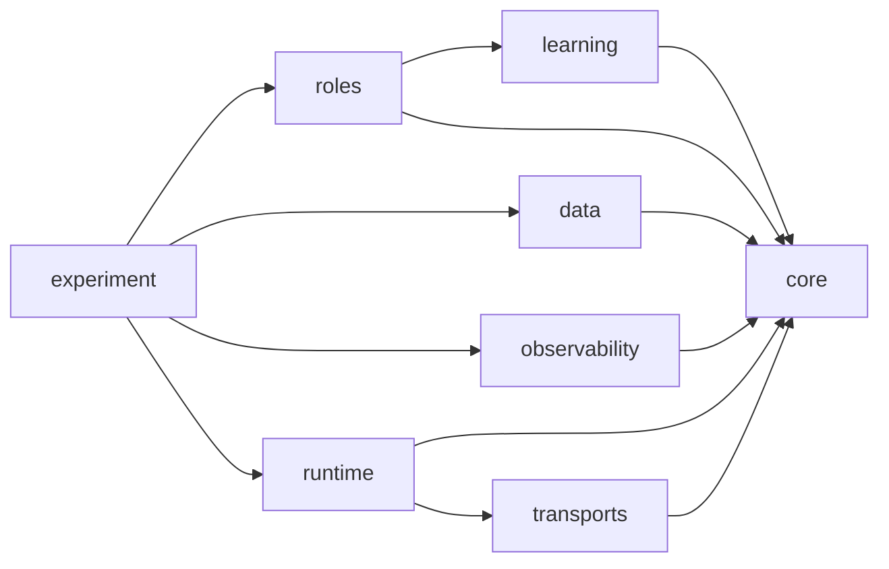
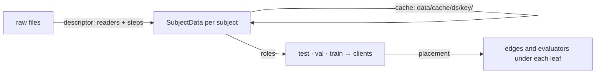
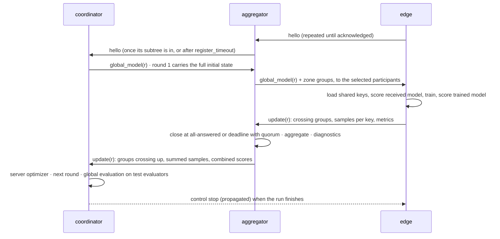

# Onion-FL architecture

This document describes the framework as built in v0.2.0. The design it implements, with the decisions and their reasons, is the spec in [superpowers/specs/2026-10-02-onion-fl-framework-design.md](superpowers/specs/2026-10-02-onion-fl-framework-design.md) (Spanish). The rules that protect the validity of results are in [RULES.md](RULES.md).

## 1. Principles

1. **Nodes are state machines.** A node reacts to `on_start`, `on_message` and `on_timer`. It reaches the world only through a `Context`: `send`, `set_timer`, `cancel_timer`, `now`, `rng`, `emit` and `compute`. The same node therefore runs in the simulator and over real transports.
2. **Every experimental axis is a plugin.** A plugin is chosen by name, or by `package.module:Name`, with pydantic-validated parameters. Its metadata (title, description, parameters and explanation) feeds the JSON Schema that the front will use.
3. **Nothing generic knows a dataset.** `roles/`, `learning/`, `runtime/` and `core/` never name SWELL, SWEET or WESAD, and a test enforces it. Datasets enter only through descriptors and `SubjectData`.
4. **Everything is measured and signed.** Each run leaves its events, a summary and the final model, under identifiers that tie a number to the topology, config, data and code that produced it.

## 2. Packages



| Package | Modules | Role |
|---|---|---|
| `core` | `message`, `codec`, `node`, `context`, `topology`, `registry`, `ids` | Messages and their encoding, the node contract, topologies and identifiers, plugin registries |
| `data` | `contract`, `ingest`, `cache`, `roles`, `placement` | From raw files to the data under each leaf aggregator |
| `learning` | `model`, `sharing`, `aggregators`, `trainers`, `metrics` | What is trained, what travels, how it is combined and scored |
| `roles` | `nodes`, `policies`, `federation` | The round protocol and the assembly of a federation on a runtime |
| `runtime` | `sim`, `real`, `network`, `devices` | Virtual-clock and wall-clock hosts for the nodes |
| `infrastructure` | `model`, `paths`, `assignment`, `network`, `failover`, `backends`, `emulators`, `calibration`, `inventory`, `probe` | The physical infrastructure, its paths, the assignment of the logical nodes to its hosts, its changes over time, the failover policies, the backends that run a scenario, the emulators they drive, the calibration of its profiles and the inventory and checks of real machines; depends on `core` only |
| `transports` | `memory`, `mqtt`, `grpc`, `flower` | Bytes between processes for the real runtime |
| `observability` | `events`, `run`, `diagnostics`, `analysis`, `sinks` | Event schema, run records, diagnostics, analysis and live sinks |
| `experiment` | `config`, `sweep`, `runner`, `backends`, `real`, `emulated`, `distributed`, `ceiling`, `fidelity`, `predictor`, `calibrate`, `microbench`, `cli` | From an experiment YAML to signed runs, their fidelity and the calibration of their profiles |

## 3. Topology

A topology is a validated tree:
- one root (the coordinator);
- aggregators on every level in between;
- a last level of edges that the placement creates.

It is written compactly, as a block per level with `defaults` and `nodes`, or as a general list of nodes; the compact form compiles to the general one. Each link has a transport, a codec and a network profile. Node settings carry the round settings: aggregator, quorum, deadline, participation, staleness, evaluation and diagnostics.

`topology_id` is the SHA-256 of the canonical tree: levels, nodes with their level, role, parent and link, and the edge link. It ignores names, declaration order and settings. `to_graph()` exports the JSON the report and the front draw, and `onion_fl topology show --mermaid` prints a Mermaid flowchart ([diagrams/](diagrams/)).

## 4. Data



- **Descriptors** (`datasets/<name>.yaml`) declare a source with readers (`csv`, `excel`, `parquet`, `pickle`, `npz`, `wesad_pickle`, `leaf_json`, `empatica_e4_csv`, `wesad_e4`, `physionet_wearable`, `stress_predict_time_logs`, `cifar_pickle`) and ordered steps (`subject`, `label`, `features`, `replace`, `join`, `window`, `multirate_window`, `intervals`, `select`, `time`, `partition`). Options fill `{placeholders}` and switch steps on with `when`. Each source file runs through the steps on its own, so memory stays bounded and windows never span two files. A whole-table step (`partition`) is the exception: the files are joined before it, and it and the steps after it run once. `partition` gives a dataset without natural subjects synthetic clients (`iid`, `dirichlet_label`, `label_skew`, as NIID-Bench) from its labels and its own seed, and makes the rows of an official test split one more subject, which `overrides.<dataset>.test` reserves. The `subject` and `label` source columns can never become features, and `features` must be explicit.
- **Empatica E4.** The E4 readers give one table with one row per sample of one signal, sorted by a `time` column: each signal keeps its native rate and the other columns of its rows are empty. `empatica_e4_csv` reads a session folder (one CSV per signal: the start in row 1, as Unix seconds or a UTC date, the rate in row 2; `IBI.csv` has offsets and may be empty), and `wesad_e4` reads WESAD's wrist, which is an E4, with the same columns plus `condition` at 700 Hz. Channels are always `acc_x`, `acc_y`, `acc_z`, `bvp`, `eda`, `temp`, `hr`, `ibi`, in that order, so every E4 dataset gets the same feature names. `multirate_window` cuts windows of N seconds from the latest start to the earliest end of the channels, reads each channel only from its own rows, takes the label from the rows of `label_rows` (all rows by default), and times a window at its end; with `label: unanimous` a window whose label samples mix classes is dropped. `intervals` gives each row the class of the (start, end) interval of another table that holds its time, for protocol tags and survey events; its column is meta. For surveys it joins a `date` column with times of day (an end that does not pass its start is the next day), reads local times in an IANA `timezone` as Unix UTC, keeps the largest class where intervals overlap (`overlap: max`), and gives the `outside` class to the rows outside every interval, but only in a source file that holds an interval of the row's key. `physionet_wearable` reads PhysioNet's Wearable Device Dataset (STRESS, AEROBIC and ANAEROBIC sessions) like `empatica_e4_csv` and adds two meta columns: `session` and `segment` (`ACTIVITY_V<version>_<k>`, with k the protocol tags pressed so far), which `datasets/physionet_e4.yaml` maps to classes. `datasets/wesad_e4.yaml` gives the same windows, labels and times as `datasets/wesad.yaml` on the wrist; the tolerances on the statistics are in its header. It is a new descriptor, not an option of `wesad.yaml`, because the cache key hashes the descriptor. `datasets/stress_predict.yaml` reads Stress-Predict's raw E4 sessions with the same features, labelled by the phases of its time log (`stress_predict_time_logs`, one row per phase in Unix seconds).
- **The cache** stores one `npz` per subject plus `meta.json` with a digest per subject. Its key hashes the descriptor and the options, not the root path. Parallel writers are safe.
- **Roles** are drawn per dataset with their own seed, before and apart from the placement:
  - `test` subjects are the global evaluators, and they are identical in every scenario; in cross-silo (`datasets/heart_disease.yaml`) a subject is one hospital's train or test split, and the overrides list each hospital's official test split as `test`;
  - `val` subjects become zone evaluators;
  - `train` subjects are grouped into clients (`subjects_per_client`), each keeping `local_val` rows: its last rows (`tail`) or the last rows of each class (`class_tail`);
  - imputation, scaling (`global`, `local` or `none`) and constant-feature removal are fitted on the training portions only;
  - `overrides.<dataset>` can set `scaler`, `impute` and `drop_constant` for one dataset, for raw columns such as pixels or tokens. Unset, they stay out of the `config_id`. A descriptor with `tokens: true` holds indices, and the runner refuses it unless its scaler is `none`.
  - a dataset with `overrides.<ds>.held_out` (leave-one-dataset-out) draws its roles as usual and keeps only its `test` subjects: nothing of it trains or is fitted, so it needs `scaler: local` or `none`.
- **Placement** gives each leaf aggregator its clients and its zone evaluators:
  - `mixing(α)` weights each dataset by home fog (declared, inherited or assigned in turns), from segregated at α = 0 to uniform at α = 1;
  - the others are `dirichlet(β)`, `label_skew(β)`, `explicit` and `pooled`, the centralised baseline with the same model and trainer.
  - The composition per leaf (samples, classes, dataset mix and its entropy) is recorded as `data.composition`.
  - In a two-level topology (`levels: [global, edge]`, the edges straight under the cloud) the root is the only leaf: it takes every client, and the global evaluators stand in for the zone ones. With FedAvg weighted by samples at every level, it reaches the same model as a tree of fogs.

## 5. Learning

**Model.** `modular_mlp` holds an adapter per dataset (or one shared adapter over harmonised features), a shared or per-dataset trunk, and a head per task or per dataset. Its parameter keys are namespaced (`adapter.<ds>.*`, `trunk.*`, `head.<task>.*`), so an edge instantiates only its own parts. Every layer is initialised from (seed, layer path), so a part starts identical everywhere.

`feature_transformer` (after FT-Transformer) keeps the same keys and options: its adapter turns each feature into a token (`adapter.<ds>`), its trunk is a class token plus attention blocks that do not depend on `n_features`, and its head reads the class token. Both families derive from `ModularModule`, which checks the datasets and heads and routes each dataset through its parts. Why these two families and not others is in `docs/superpowers/specs/2026-11-10-onion-fl-model-families-design.md`.

**Sharing.** Each parameter group has a scope:

| Scope | Meaning |
|---|---|
| `global` | Aggregated up to the coordinator |
| `level:<name>` | Aggregated up to that level; its aggregator keeps it and injects it into what it sends down |
| `local` | Never leaves the edge |

A group crosses a link, in both directions, when its scope is `global`, or `level:X` with X at the parent's level or above it. The presets are `fedavg`, `fedper` (local heads), `lg_fedavg` (local adapters and trunk, global heads), `zone(level)`, `independent` and `harmonized`; `custom` takes rules by glob.

**Aggregation.** Aggregators work per key, only among the contributions that hold it, and send up the summed samples, so a tree of `fedavg` equals a flat FedAvg. Contributions are sorted by sender before combining. The aggregators are `fedavg`, `mean`, `median`, `trimmed_mean(β)` and the robust and private ones below. The coordinator then applies a server optimizer, `replace`, `fedavgm`, `fedadam`, `fednova` or `feddyn`, with the round's statistics. These are `train_*` metrics reduced up the tree (steps and loss averaged by examples, examples and edges summed) plus `edges_total`. `learning.server_optimizer` overrides the topology's root setting. Aggregators are called as `aggregate(contributions, source, reference, rng)`, where `reference` is the state the node sent down that round and `rng` is a child random stream. An optional `report()` lists diagnostic events the collector emits: `diagnostic.selection` (children dropped from the selection, the dropped ones not used at all, `f_used`, and the sources of each rescued key), `diagnostic.scored_keys` (the common model keys a robust aggregator scored; with 0 it cannot tell children apart), `diagnostic.clipped` and `diagnostic.privacy_epsilon`. The collector counts the dropped, the excluded and the aggregated children against edges tagged `malicious`. Bulyan picks its θ = n − 2f candidates with Krum one at a time, removing each pick before the next. The robust aggregators (Krum, Multi-Krum, Bulyan, geometric median) score whole updates over the model keys every child holds, lower `f` when too few children answer, and combine each key over the selected holders; a key only dropped children hold comes from its best-ranked holders. `norm_clip` and `dp_fedavg` clip each child's update against `reference`; `dp_fedavg` and the edge-side `local_dp` report ε per round. Central DP uses add/remove-one-child adjacency with the arrived count m treated as public; local DP uses replace-one adjacency (sensitivity 2C). Both assume C was fixed in advance. The edge's attack and privacy hooks see only the keys it sends up, and `local_dp` leaves the trainer's frozen groups as they arrived. `dp_fedavg` would noise them, so it is refused with a trainer that freezes a group (FedBABU's head). An `attack` plugin on a seeded fraction of edges poisons their data or the model keys they send. A server optimizer is called as `apply(global_state, aggregated, stats)`; one written for the old two-argument form needs the third.

**Auxiliary arrays.** A trainer can return arrays named `<algorithm>/<parameter key>`, for example SCAFFOLD's control variates or FedNova's normalised update. They travel where their parameter travels and are combined per key. Server optimizers replace them instead of stepping them, and diagnostics ignore them. Clipping, noise and attacks do not touch them either, so a trainer that sends them is refused together with `privacy`, `attack`, `dp_fedavg` or `norm_clip`.

**Training and initialisation.**
- Trainers: `standard` (epochs, batch, learning rate, optimizer, frozen groups) and `fedprox(μ)`.
- Drift trainers: `moon` (contrast on `ModularMLP.features`, refused when sharing keeps the adapters or trunk local) and the pairs `scaffold`, `fednova` and `feddyn` (trainer + server optimizer, checked before the first scenario, and refused with any staleness but `drop`, because the round statistics count only fresh updates). SCAFFOLD edges send the change in their control variate and the `scaffold` optimizer keeps `c`. SCAFFOLD and FedNova accept only SGD.
- **Participation per group.** Every edge announces in its `hello` the parameter groups it sends up, and aggregators add them up, so the root's statistics carry `edges_total/<group>`. Updates carry `train_edges/<group>`, summed up the tree. `scaffold` and `feddyn` scale their server step by the share of each key's holders that trained, and their trainers ask for one vote per edge (`uniform_weights`), as in their papers.
- **Divergence.** An edge whose training leaves non-finite weights reports `edge.train_failed`, rolls its model back and sends nothing. The trainer's memory rolls back too when it offers `snapshot()` and `restore()`; the built-in trainers save only what a diverged round must undo, and a plugin without them is not copied.
- Personalisation trainers: `ditto(λ)` and `apfl(α)` keep a personal model per edge across rounds and expose it through `personal()`. `fedrep` trains the local head, then the shared body, and declares the head as `local_groups`: `plan` refuses a sharing policy that sends it up. `fedbabu` freezes the head.
- `stub` learns nothing and is for protocol tests; with `noise` each node sends a different, seeded update.
- Inits: `random(seed)`, and `checkpoint(path, groups)`, which loads a saved `model.npz` such as a pooled run's.

**Metrics.** `loss`, `accuracy`, `macro_f1`, `recall_per_class` and `confusion_matrix` give scalars. When reports are combined, scores are averaged by samples and confusion counts are summed.

## 6. Round protocol



- **Registration.** A child repeats its `hello` until the parent acknowledges it, so a lost message does not stall the tree.
- **Closing a round.** A round closes when every participant has answered, or when the deadline passes with quorum (an int is a count, a float a fraction). With `close_at_quorum: true` it closes as soon as the quorum is in, late updates included, and a child still training gets no newer model until its staleness policy would drop that update. Participation is drawn among the free children, and a round whose children are all busy waits for a late update (or its deadline) instead of closing empty. This is hierarchical buffering inspired by FedBuff, with the cloud still synchronous. A round its parent overtakes before it closes keeps its updates as late ones and emits `round.abandoned`. Without quorum, the aggregator sends an empty update and emits `round.quorum_failed`; the late updates it held wait for the next round, one round older, while the round's own updates are lost.
- **Late updates.** They go to a staleness plugin: `drop`, or `next_round` with a `constant` or `polynomial` weighting. A kept update joins as its change from the model it trained on, applied to the model sent in the round it joins. Its age is counted in global rounds (the root's numbering, which every level keeps) when it joins, so a node the parent skips, with `fraction` participation or because it was busy, sees its late updates age by the rounds it missed; `update.late` reports the least age it can join with, and the `participation` diagnostic's `late` counts the late updates since the last diagnosed round, those that arrived between two rounds included. Each collector reports `staleness`, the mean age of what it combined plus what each contribution carried (absent when 0), weighted as each contribution enters the aggregate (its largest per-key weight: its samples, times the staleness factor for a late one), and the root passes it to the server optimizer. With `polynomial` weighting at the fogs and `fedasync_mix` at the root a late update is discounted twice, in its weight at the fog and in the mix; a `constant` factor of 1 below, or `a: 0` at the root, keeps one of the two. On MQTT, which updates arrive first depends on wall-clock timing, so runs that close at quorum are not reproducible there.
- **Participation.** It is `all`, or `fraction(p)` drawn with the node's own RNG stream. System-aware plugins choose from what a real coordinator knows, never the true profiles: the node tells them how long each child it asked took (from the round's opening to its answer), or, for one that did not answer by the close, how long the round lasted. Children never observed go first, by name. `fastest_k(k)` keeps the `k` with the lowest mean time; `deadline_feasible(threshold)` keeps those whose share of rounds answered in time (before the close, and before its own `deadline` if given) reaches the threshold, or the likeliest one if none does; `utility(k)` is a simplified Oort, samples × last training loss, times `(T/t)^alpha` when the estimated time `t` passes the preferred `T` (by default the median estimate). None of them draws random numbers.
- **Failures.** A failed training is `edge.train_failed`, and the edge counts as absent. A malformed message, or one from an unknown sender, is `message.rejected`. No node error stops a run.
- **Evaluation.**
  - Edges score their `local_val` every `edge.every` rounds: the model received and the one trained, plus `personal` (if the trainer has a personal model) and `finetuned` (the received model after the `edge.finetune` trainer, which draws from a child random stream so it never changes training).
  - Aggregators combine the scores of their children, and ask their `val` evaluators to score the zone model every `aggregators.every` rounds.
  - The coordinator asks the `test` evaluators to score the global model every `global.every` rounds, and always after the last one. It reports per dataset.

## 7. Runtimes and transports

**SimRuntime.**
- One queue ordered by (virtual time, sequence), with `start`, `deliver`, `timer` and `compute_done` events.
- Links schedule each direction FIFO, with latency (fixed, normal or lognormal), jitter, bandwidth and loss; the presets are `lan`, `wifi`, `4g` and `lora`.
- `ctx.compute(samples)` keeps a node busy for the time its compute model gives. What it sends leaves when the work ends, and what arrives meanwhile waits.
- Compute is `samples_per_second` (fixed rate), `measured` (wall time × factor), `lognormal_rate` (a lognormal rate per task, with the mean duration of `samples_per_second` and dispersion `sigma`) or `trace` (each task lasts one of the measured `durations`, drawn uniformly). A model whose `duration` takes `rng` draws from the node's compute stream, `node_rng(seed, "<node>/compute")`, apart from the node's own stream; the others are called as before.
- Availability is `always`, `bernoulli`, `schedule`, `crash_at` or `windows` (up inside `[active[i], inactive[i]]`, repeated every `period` when given: FedScale's availability trace). An offline node drops what it receives; its start and its timers wait until it is up again, and are dropped only after a crash.
- Each node keeps one RNG stream for the whole run, so a seed gives the same events.

**RealRuntime.**
- The same `Context` on the wall clock, with one loop thread.
- A process hosts its group of nodes and knows the others only to declare links.
- Messages travel in a frame `codec \0 header \0 message`. The JSON header carries `msg_id` and `sent_at`, which the receiver puts in `meta`, so it records the same id and the end-to-end latency. The message is encoded as in simulation: `message.sent` counts its bytes, and the frame's go in the `frame` tag.
- Every node emits `node.heartbeat`.

**Transports.** `mqtt` gives each node an inbox at `onionfl/<run_id>/<node>/inbox`, with QoS and broker per link; it reconnects and resubscribes after a broker restart. It holds one connection to listen and one to publish, and starts once every inbox is subscribed: over a single connection, a process sending large messages to nodes it hosts itself stalled behind Docker Desktop's port forwarding on Windows (#192). With its default configuration, the `eclipse-mosquitto:2` image (2.1.2) refuses a packet of about 2 MB or more and drops the client (`oversize packet` in its log): a larger model needs a broker configured for it. `grpc` has no broker: each process serves its inboxes on one gRPC server (`127.0.0.1` and a free port by default), announced by a file per inbox in a discovery folder (across machines, an explicit `peers` map from each inbox to its `host:port` replaces the folder), and a sender delivers the frame straight to it (one generic bytes method, no `.proto`). One queue and one thread per inbox keep the order; a failed delivery retries with backoff and reads the inbox's file again, so a receiver not up yet, or restarted on another port, is found; on `stop` what is queued gets one more try within `flush_timeout`. It needs the `grpc` extra. `flower` (issue #204, the `flower` extra, Flower >= 1.21) uses the same links, under its own service and discovery folder, and puts each frame in a Flower `Message`: a `RecordDict` with the frame, and `Metadata` with the inbox as `group_id` and `message_type` `query`, as Flower's protobuf. Flower carries the bytes and never drives the rounds; its SuperLink and SuperNodes are not used, because the Fleet API only lets a SuperNode reply to what the ServerApp sent (a `hello` or an update could not leave unasked), one SuperLink is a single level, and Flower starts the apps itself. `memory` is an in-process bus for tests.

**Backends** (I1 §10). Every scenario runs on a backend from the `backends` registry (`infrastructure.backends`), chosen by the experiment's `backend:` or, without it, by `runtime.mode` (`real` is an alias of `local`; unset, the `config_id` does not change). The contract is `supports(infrastructure)` (the reasons it cannot reproduce it; the config refuses any), `prepare(scenario, infrastructure, assignment)` (an execution plan), `run(plan)` and `collect(plan)` (the signed run). `execute` chains them. The backends live in `experiment.backends`, since they build federations:
- `sim`: the simulator in one process (`runner.simulate`);
- `local`: the real runs below, on this machine; it refuses an infrastructure;
- `emulated`: the same processes in containers, one per host, with the infrastructure's resources and network emulated (below);
- `distributed`: the same processes on real machines, one per host, launched over SSH (below).

`onion_fl run --backend NAME` overrides the experiment's; `--mode real` still works.

**Real runs** (the `local` backend).
1. `prepare` checks the links (MQTT or gRPC) and the MQTT brokers and writes `scenario.json`.
2. `run` starts one `onion_fl node` process per group: the root with the test evaluators, and each aggregator with its edges.
3. Each process rebuilds the same scenario and writes its own event file.
4. When the run finishes, a stop travels down the tree and the processes exit; `collect` merges and signs the run.

With full quorum and the same seed, simulation, MQTT, gRPC and Flower give the same final model. `tests/test_runtime_equivalence.py` checks it (Flower only with its extra; the tests skip without it), pairs `local` over gRPC with `local` over Flower (the same model bit for bit and the same bytes per link), and compares `local` over MQTT with `local` over gRPC through the fidelity harness: the design id ignores the links' `transport`, so the two pair, and the harness measures their difference in time while the bytes per link stay the same.

**Emulated runs** (the `emulated` backend, I1 §11; the emulator was chosen in `docs/decisions/2026-11-06-i9-emulator.md`). It needs Docker and an infrastructure with an `mqtt_broker`.
1. `prepare` resolves the assignment and writes `runs/<run_id>/emulation/`: the Compose project that `infrastructure.emulators` generates and one setup script per container.
   - One container per host that runs logical nodes, with `NET_ADMIN` and its profile's `cpus` (CPU quota) and `memory` (memory limit).
   - A router per site, and a Docker network per site LAN and per physical link on a path between the hosts. netem runs on each router's end of a link (the `up` rate at `between[0]`, the `down` rate at the other end), and static routes follow the path of least latency.
   - The LAN is shaped on each host's egress, for destinations in its own site only. The broker runs in the network namespace of its host.
   - `scenario.json` carries the paths as the containers see them (under `/onionfl`; only the runs are writable, and the prepared data comes from the cache), the logical nodes of each host (`groups`) and the broker's address.
2. `run` brings the project up and waits until every container has shaped its interfaces and the broker answers. It then restarts the run's clock and starts one `onion_fl node` per host with `docker exec`. The project is always taken down, and its logs are kept in `compose.log`.
3. `collect` merges and signs the run as `local` does. `run.json` adds `emulation`: the project, the image, the containers, every tc command and the setup time.
- **Image.** `onionfl-emulated:latest` by default. It is built from `infrastructure/emulated.Dockerfile` the first time, with the launcher's versions of torch, numpy, scipy, pandas and scikit-learn; a label records them, and other versions rebuild it. Another torch initialises the model with other bits. The `onion_fl` source is mounted, not copied.
- **What the shaping means.** `bandwidth` is the rate netem shapes, Ethernet frames included; TCP gets about 95.6 % of it. netem's queue holds the link's bandwidth-delay product plus 1000 packets. `loss` is per packet: over MQTT and TCP it becomes retransmissions and delay, never a lost message as in `sim`. A physical link is one queue for all its traffic, as with `shared` in `sim`; a LAN is shaped per host, not shared.
- **Refused.** `network.schedule`, `bandwidth: dedicated`, lognormal jitter and an infrastructure without `mqtt_broker`. `plan` shows the containers and refuses more than `max_containers`.
- **Parameters.** `image`, `broker_image`, `project` (the prefix of every container and network), `subnet` (`10.195.0.0/16`, a /24 per network), `max_containers` (64) and `ready_timeout` (120 s, also the processes' extra time to start).
- With Docker and the image present, `tests/test_runtime_equivalence.py` checks that the final model is the simulation's bit for bit and that the bytes per logical link and round are the same. The comparison of `sim` and `emulated` is in `results/fidelity_emulated/`.

**Distributed runs** (the `distributed` backend, I14). An inventory (`infrastructure.inventory`, a YAML file or inline) says which real machine plays each host: its SSH `address`, `port`, `user` and `key` (a path, with `~` and `$VARS`; the inventory has no field for a secret and refuses a key's content), its `python`, its working `root` (relative to the home), the `advertise` address the other machines use, its `grpc_port` and `listen` interface, and `env` for its processes; and, for all of them, `known_hosts`, `host_key_check`, `connect_timeout` and how clocks are checked (`clock.reference`: `launcher` or `ntp`, `max_offset`, 0.05 s by default). Every value that reaches a command line is checked: addresses are hostnames, IPv4 or bracketed IPv6, users are POSIX names, paths and commands may not start with `-` or hold control characters, and `ssh` gets `--` before the destination. The launcher only needs the system's OpenSSH client; a machine needs `sh`, `tar` and a Python with `onion_fl`.
1. `prepare` resolves the assignment (the logical nodes of each host, as `emulated` does), refuses a host without a machine, a `network.schedule` and gRPC links with different settings (one gRPC server per machine), and runs the **preflight** on every machine at once: `infrastructure.probe`, sent as source over SSH, reports the Python version, the digest of `onion_fl`'s source with line endings normalised (it must equal the launcher's), the numeric libraries (another version is a warning: the bits may differ from `sim`), the data cache's `meta.json`, and the NTP offset when asked. It holds the machine's gRPC port open while the launcher takes clock samples over the open session (offset from the shortest round trip, as NTP) and then asks each machine whether it reaches the broker and every other machine's gRPC port. Any failure refuses the run with every reason at once, before a run folder exists.
2. `run` sends each machine, under its `root`, one tar stream over SSH: the config's YAML folders, the descriptors, the data cache it lacks (`push_data`, on by default; off, a missing cache fails the preflight), then `scenario.json` (paths relative to the root, `groups`, the broker every MQTT link takes, the gRPC `listen` and `peers` maps) and the launcher's `initial.npz`. It restarts the run's clock, starts one `onion_fl node` per host over SSH (its pid kept so that a process left behind is stopped), and brings back every `events.<host>.jsonl` and the root's `model.npz`. A machine may send back only its own event file (and the model, from the root's host): another host's file, a duplicate, a link, a path or an oversized archive refuses it and fails the run instead of signing it.
3. `collect` merges and signs the run as `local` does. `run.json` adds `distributed`: per machine its address, Python, platform, `onion_fl` version, numeric versions, clock offset and round trip; the broker, the transports, the warnings, the data sent and the files brought back. No key path is recorded.
- **Broker.** The host of the infrastructure's `services.mqtt_broker`, at its `advertise` address and `mqtt_port` (1883), or the backend's `broker`.
- **Machine image.** `infrastructure/distributed.Dockerfile` adds an SSH server to the emulated host image, so a Linux server or the development PC joins through Docker; the public key comes from `AUTHORIZED_KEY` when the container starts.
- **Parameters.** `inventory`, `broker`, `mqtt_port`, `push_data`, `ssh` (the client), `clock_samples` (5), `probe_timeout` (60 s) and `grace` (60 s, the processes' extra time to start).
- With Docker, `ssh` and the emulated host image, `tests/test_runtime_equivalence.py` starts five containers acting as machines (SSH server, Python, this checkout mounted) and checks, over MQTT and over gRPC, that the final model is the simulation's bit for bit and that the bytes per logical link and round are the same. Real hardware (a Raspberry Pi among at least three machines) and the mobile spike are pending: `docs/distributed-hardware.md` says what to check and how.

## 7a. Infrastructure

The federation is logical; an `infrastructure:` puts it on machines (spec `docs/superpowers/specs/2026-11-03-onion-fl-infrastructure-design.md`).

```yaml
infrastructure:
  name: edge_fog_cloud_lab           # infrastructures/<name>.yaml, a path, or inline
  assignment:
    root: cloud-1
    aggregators: {fog_a1: fog-1, fog_a2: fog-1}
    edges: {name: explicit, hosts: {"swell-*": field-raspberry_pi-1, "*": fog-1}}
```

- **Model.** Profiles (`train_rate` and its optional lognormal dispersion `train_sigma`, `aggregate_rate`, `cpus`, `memory`), sites with named hosts and pools (`field: {pool: {raspberry_pi: 20}}` gives `field-raspberry_pi-1..20`), links between sites, and services such as the MQTT broker.
- **Paths.** Two nodes on one host talk for free; on one site, through its `lan`; across sites, along the path of least latency. The path's profile adds latencies, combines jitters as √Σσ², takes the narrowest bandwidth per direction and composes losses as 1 − ∏(1 − pᵢ); one segment keeps its profile exactly. Through a broker a path is two legs with the hop `via:<host>` between them: the broker forwards a message once it has all of it, so the legs' bandwidths (each its narrowest segment) add in series, 1 / Σ(1 / bₗ), and a message from a device to its fog through a cloud broker crosses the fog–cloud link twice (#197).
- **Assignment.** The coordinator and the aggregators go to hosts by name; the edges, by an `assignments` strategy: `explicit` (names or patterns), `one_per_device`, `profile_mix` (fractions rounded by largest remainder), `by_dataset` and `colocated` (`per_host` edges per device). The pool strategies draw devices from the pools (named hosts are servers), optionally from some `sites`, in an order drawn from their own `seed`: changing it moves edges, never their data. `coupled` takes the devices `profile_mix` would and pairs them with the edges so that a statistic of each edge's data (`samples`, `label_divergence`: the KL divergence of its labels from its dataset's, or `initial_loss`) and its device's `train_rate` have a target rank correlation `rho`: a Gaussian copula on the strategy's own seed, its latent correlation chosen so that the expected Spearman for that many edges is `rho` (Moran's formula). `rho = 0` is `profile_mix` in distribution, and `rho` only permutes edges over the same devices; `plan` shows the statistic and the Spearman achieved under `infrastructure.coupling` (devices of equal speed tie, so it can fall short of `rho`). `assignment.services` moves a service, such as the broker, to another host. The assignment is part of the `config_id` and can be swept.
- **Device traces.** A site's `traces: {source: fedscale, devices: N, seed: S}` samples `N` of FedScale's real clients (`onion_fl.infrastructure.fedscale`, issue #253): each becomes a profile `fedscale_<site>_<i>` with one device in the site's pool, so the pool strategies (and `coupled`, by speed) take them as any other. Capacity and availability clients are drawn without replacement from `node_rng(S, "fedscale/<site>/...")`, so the same seed gives the same profiles. The mapping is FedScale's: `computation` is a model's inference latency in ms per sample and training costs three times it, so `train_rate = 1000 / (3 · computation)` samples/s; `communication` is kbit/s, so the profile's `bandwidth` (the device's own access segment, `host:<host>`, crossed first when it sends and last when it receives) is `1000 · communication` bit/s; the availability client's windows become the profile's `availability` (`windows` with its `finish_time` as period), which its edges take (a topology `edge.availability` on such a host is refused). The traces are pickles: `onion_fl traces import fedscale` reads them once with an unpickler that builds only plain values and writes `capacity.csv`, `behaviour.jsonl` and a `manifest.json` with every file's SHA-256; a run reads only those, refuses them if they no longer match, and records under `device_traces` in `run.json` (and in `plan`) the source, license, hashes, seed and the clients drawn. These profiles say `origin: trace`: like declared ones they are not calibrated (§13 of the spec, #197), and a fidelity result cannot rest on them. The fields an infrastructure leaves unset (`bandwidth`, `availability`, `origin`, `traces`, `device_traces`) are not part of its `infrastructure_id`, so existing ids do not change.
- **What the runtimes see.** Each logical link gets its path's profile and each edge computes at its host's `train_rate` (`lognormal_rate` around it when the profile has a `train_sigma`; an infrastructure without one keeps its id), and with its host's `availability` when the profile has one; evaluators sit on their parent's host. `SimRuntime` knows nothing of sites or hosts.
- **Network.** With `network.bandwidth: shared` (the default) each direction of a segment (a site's LAN or a link) is one FIFO queue for every logical link that crosses it: a message waits until all the segments of its path are free and is through after its size over the narrowest one (through a broker, leg after leg), so two flows on a link of capacity c get c/2 each; `dedicated` gives each logical link its path's full bandwidth. Uncontended, the two are the same, and so on the implicit infrastructure. An MQTT link goes child → broker → parent when the infrastructure places an `mqtt_broker`. `network.schedule` changes a link at a time (`set` fields, `down: true/false`, or a `trace` CSV, one change per row), recorded as `link.changed`, `link.down` and `link.up` of the node `network`; a message sent while a segment of its path is down is lost (one already in flight still arrives). `SimRuntime` sees only channels (`add_link(channel=...)`), never segments.
- **Resources.** Nodes on a host with `cpus` share it: at most `cpus` jobs at once, the others wait in FIFO order (`host.queued`, valued by the wait). Combining a round costs the aggregator's host the bytes combined / `aggregate_rate`, so an overloaded fog closes later; without `aggregate_rate` it is free, as before. `plan` refuses a host whose nodes' models and data do not fit in its `memory` (every node counted with the whole initial model, an upper bound); swapping is not simulated.
- **Dynamic continuum.** A `network.schedule` entry with `host:` takes a host `down: true` with every logical node on it, and `down: false` brings it back (`host.down`, `host.up` of the node `network`; `SimRuntime.host_offline`): what reaches its nodes meanwhile is dropped and their timers wait, as with a node's own availability. `infrastructure.failover` (registry `failovers`: `none`, the default and today's behaviour, `nearest_alive`, `explicit`) moves the training edges of a leaf aggregator whose host is still down `after` seconds later: the policy picks among the leaves whose host is up and that have room (`max_children`, a leaf setting), the old parent releases the edge, the new one adopts it and a link is compiled between their hosts, and the edge says hello to it (`edge.reparented`; `edge.unparented` when no candidate is left). The same way, at the start, a leaf with more edges than its `max_children` sends the rest on; without a failover, `plan` refuses it. Protocol rules: the update an edge had in flight goes to its old parent and is lost, or dropped as from a stranger if that parent comes back; the old parent's quorum counts the children it has left; the edge enters only rounds its new parent opens after its hello, and answers idle to a round it already took, so no edge contributes twice to a round. Its first model from the new parent is whole, with that zone's groups; its data do not move. The control plane is the simulator's: it knows when a host is down, so no heartbeat is modelled.
- **One source of truth.** With an infrastructure, a `link_up.profile` or an edge `device` in the topology is refused. Without one, nothing changes: the ids are the same and the topology's links are the implicit infrastructure (`tests/test_infrastructure.py` checks that an infrastructure reproducing it gives the same events).
- **Calibration** (I1 §7, §13; `infrastructure.calibration`, `experiment.calibrate`). A profile or a link can cite `calibration: <calibration_id>`, a signed folder `calibrations/<calibration_id>/` (`calibration.json` and its `measurements.jsonl`; the id is the SHA-256 of the canonical JSON, which includes the measurements' SHA-256). A profile that cites one takes `train_rate` and `aggregate_rate` from it, refuses to give them too, and must have the `cpus` and `memory` it was measured with; the training rate is per workload (`workload_key`: the shapes of the edge's parameters and the trainer's `batch_size`). A workload the calibration did not measure on that profile is estimated from the measured one nearest in FLOPs per sample (6 per parameter), scaled by their ratio, and the sim run lists it under `estimated` in `run.json` (with `calibrations`, the ids it cites); `onion_fl fidelity` refuses runs with `estimated`. A link that cites one keeps its own fields for the emulator and gives the simulation the latency, bandwidths and loss measured over it (`paths.segment`). `paths.calibrations` (default `calibrations`, left out of the `config_id`) is where they are found. `coupled` orders calibrated devices by the FLOPs per second of their fastest workload.
- **Calibrating.** `onion_fl calibrate measure <spec.yaml> --out <session>` brings up the emulation of the spec's hosts and runs `experiment.microbench` in them: per workload, every train host trains its clients' real training rows at once (cohabiting, as the I9 spike advised), then the aggregate hosts run `fedavg` at once, each phase starting on every host at the same instant; then, one at a time with the hosts idle, MQTT messages of several sizes go through the infrastructure's broker in both directions of each pair, one-way delays stamped with the containers' shared clock. A spec's `pin` gives every host fixed CPUs of Docker's VM (`cpuset`, one per profile CPU, so torch runs one thread per CPU) and the routers and broker another set; `train.warmup` trainings per host are left out; each phase records the machine's busy and performance counters and the VM's load before and after it (`load`); `links.nodelay` sets `TCP_NODELAY` on the clients and the broker. `fit <session>...` takes one or more sessions of one spec. In each, it keeps the trainings and combinations taken while every host of the phase was busy, fits each rate as total work over total time, each path as `delay = a + c·size` over its messages up to `links.fit_up_to` bytes (the first message of a pair is a warm-up), the links' latencies by least squares over the paths that cross them, and their bandwidths by least squares over the paths' slopes, each leg sent at its narrowest segment's rate; a link's loss is the lowest of its paths'. Within a session every interval is a bootstrap; over k ≥ 2 sessions each value is the geometric mean of theirs and its interval the 95 % prediction interval of one more session's value, `exp(m ± t₀.₉₇₅,ₖ₋₁·s·√(1 + 1/k))` on the logs (`Estimate.sessions` lists them), and losses pool the messages. The calibration keeps each fit session's digest, start, code, CPUs and load, each path's delay per size (`paths`), and `valid_up_to`, the largest size its path model holds; with `--infrastructure-out` it also writes the infrastructure that cites it. `check <session> --infrastructure <file>` refuses a session the calibration was fitted on; for another, every rate, link field and path delay it measured must fall inside the calibrated interval, and so must the simulator's prediction of each path (`acceptance`); the prediction inside the session's own interval is reported as `inside_session_ci`. A sim run that sends a message larger than `valid_up_to` over a logical link crossing a calibrated link lists it in `run.json` (`outside_calibration`), and `onion_fl fidelity` refuses it, as it refuses `estimated` rates.
- **Not yet.** The `local` backend refuses an infrastructure (I10, I14); `emulated` and `distributed` take one. Mobility (a host changing site) comes later; so do a down broker cutting the links through it, failover of aggregators that are not leaves, and edges moving back when their parent returns.
- `plan` shows each node's host, each host's load, the services and each link's path and profile; `run.json` records `backend` (`sim`, `local`, `emulated` or `distributed`; runs from before the backends say `real`), `infrastructure_id` and, with device traces, `device_traces`.

## 7b. Continuing a run (continual)

- **Bundle.** Every simulated run writes `runs/<run_id>/bundle/` (`onion_fl.continual.bundle`), which `run_hash` covers. It holds the state `snapshot_federation` captures, with `.npz` and JSON only:
  - the global model, round and server optimizer;
  - each aggregator's zone, previous aggregate and own state (the central DP budget);
  - each edge's model, trainer memory (`export_memory`), local DP budget, replay memory and what its stream consumed (`stream/consumed_by`), saved together so a row is either kept or unconsumed, and, with an unlabelled objective, the rows it used unlabelled and the audit of each pseudo-label (`unlabelled/*`);
  - every node's random stream (`rng_state`, with its spawned children).

  Next to that state it keeps the lineage and, per dataset, what the whole lineage knows of it, even when this run does not load that dataset: the frozen preprocessing (`DataSplit.preprocessing`), the task and classes, and every subject that ever trained, validated or tested. A subject keeps its role along a lineage, so these roles stay a partition.
- **Continuation.** `learning.init: {name: run, run, restore}` verifies the parent and refuses a continuation that cannot be exact or would leak (spec §6). Then it:
  - re-applies the frozen preprocessing, bit for bit;
  - continues the round numbering;
  - restores what `restore` asks for, through `restore_federation`;
  - records the parent in `run.json`.
- **What `restore` covers.**
  - `model`: every model weight, meaning the global model, the zones, the previous aggregates, the edge models, and the trainer memory that holds weights (marked `weights` by `export_memory`).
  - `edge_state`: the rest of each edge, meaning its trainer memory (SCAFFOLD's c_i, for example), its replay memory, what its stream consumed (labelled and unlabelled, with the pseudo-label audit), and its random stream. Restoring a stream and its memory waits for streams to continue.
  - `server_state`: the server optimizer, and the algorithm state riding in the global model as auxiliary keys (SCAFFOLD's c). SCAFFOLD and FedDyn need it restored together with `edge_state`.
- **DP budgets.** They always carry over. Each budget (`privacy.Accountant`) is the Rényi DP accumulated at each order, Σ α/(2σ²), so σ may change between generations and ε stays right.
  - An edge with a budget also keeps its random stream, since a fresh one would replay its parent's noise.
  - The bundle carries the nodes a run lacks, as the run kept them, so a node that skips a generation keeps its budget.
- **Changes allowed.** New datasets get a fitted preprocessing and fresh adapters. `group_lr` can scale the steps of the groups a continuation keeps.

## 7c. Streams (continual)

- **Time per row.** `SubjectData.t` holds each row's seconds since the subject's first observation. It is metadata, never a feature, and comes from the `time` ingest step: a parsed column, or the row position at a rate. A window is timed at its last row.
- **The schedule.** `data.stream.edge_stream` turns one edge's rows plus `stream` and `labels` into an `EdgeStream` in continuum time (data time since the stream started). It is a pure function of the rows, the config and the seed. For each row it gives:
  - `available_at`: rows arrive in batches, each at its last row; rows before t₀ are history, there from the start;
  - `label_at`: a seeded fraction of the rows, each labelled `delay` after it arrived, ∞ for the rest;
  - `trainable_at`: once both the row and its label have arrived.
- **The edge works lazily.** When a global model arrives, the edge reads `ctx.now()` × `speed` and handles what arrived since the last round:
  1. it predicts the new rows with the model it was serving, and stores the predictions;
  2. it scores `prequential` (every arrival against its truth, which only the simulation knows) and `prequential_labelled` (the stored predictions whose label arrived) into its update metrics, which the collectors reduce per fog and globally;
  3. it emits `data.arrived` and `data.labelled`;
  4. it serves the new model, and trains on every trainable row not yet used (`window`, when set, caps how old a row may be). A row counts as used, with its round, only once that training ends with finite weights.

  The served model only changes when a global model arrives, so the lazy handling is exact and needs no timers.
- **Idle rounds.**
  - An edge with nothing to train on answers idle, with its scores.
  - Collectors leave idle children out of the quorum, and a round where every child is idle closes as `round.idle` without changing the model.
- **Pacing.**
  - Without `continual.trigger`, the coordinator opens a round every `round_every` of data time (`round_every` / `speed` virtual seconds).
  - The observations end with the last row. The run then drains: it lasts until one round after the last chosen label arrives, bounded by `rounds`. With `continual.trigger`, triggers pace it instead (below).
- **Participation.** An edge handles its stream when a round reaches it, so streams require participation `all`. `close_at_quorum` and time-based availability stay outside the temporal guarantee. With a trigger, an edge without an update answers idle instead of being left out.
- **Evaluation.** Validation evaluators with a stream score what arrived since their previous request. Test evaluators score whole test subjects, so the final test score stays comparable.
- **The bootstrap fit.** `split_subjects(fit_rows=...)` fits the preprocessing on the rows before t₀ only.
- **Replay memory** (`continual: {memory, replay_ratio}`, `onion_fl.continual.memory`).
  - **Plugins.** `none`, `fifo`, `reservoir` and `class_balanced`, each keeping indices into its edge's own stream on a stream seeded per edge. An external one follows the `Memory` protocol, which the edge checks when it is built, together with `replay_ratio` in [0, 1) and the stream a memory needs.
  - **What enters.** The rows of a training that ended with finite weights, offered in time order: nothing enters on a failed training, even if its round then fails for other reasons.
  - **Replay.** Each training adds r·n / (1 − r) rows sampled from the memory to its n recent ones. An edge with nothing new stays idle.
  - **Weight.** The edge is weighted by its n recent rows, as it would be without a memory: a replayed row was weighted when it was new.
  - **Records.** After each training that worked, the edge reports `diagnostic.memory`: the memory as it is now, the rows that training replayed, and the mean age of what is kept since it was observed. The bundle saves the memory.
- **How an edge updates** (`continual.update`, the baselines of the benchmark, C8).
  - `warm`, the default, goes on from the model received and trains on its new rows, as above.
  - `frozen` trains only with the first model it gets (v0, on its history) and then answers idle, so the global model stays v0. An edge with no labelled row in its history takes no part in v0.
  - `scratch` serves the model received, but starts every training from the initial weights (the first model it got) and trains on every trainable row it has, used or not, weighted by all of them. It trains only in the rounds where `warm` would, when new rows arrived.
  - `frozen` and `scratch` take no replay memory and no unlabelled objective, at the config and when the edge is built.
  - `scripts/continuum_benchmark.py` measures the benchmark from run folders: prequential, the area under the per-round held-out curve, the final model, forgetting, recovery after the first change of the arriving class, costs and promotions.
- **Unlabelled rows** (`unlabelled: <objective>`, `onion_fl.continual.unlabelled`).
  - **Plugins.** `none` (the default: C3/C4 unchanged), `pseudo_label` (`threshold`, `weight`) and `consistency` (`noise`, `weight`). An external one follows the `Objective` protocol (`size`, `fit`, `term`), which the edge checks when it is built, together with the stream it needs.
  - **The pool.** Rows that arrived (history included, capped by `window`), whose label is not there yet, and that no successful training has used unlabelled. A row whose label arrives later still trains as labelled. Each row is looked at once: a pool row counts as used, with its round, once the training ends with finite weights, even when `pseudo_label` rejected it.
  - **No labels leak.** The edge hands the objective the pool's features only. `fit` sees them once with the model as received (`pseudo_label` keeps the class of each row whose max probability reaches `threshold`); the trainer then adds `term` over a chunk of the pool to each labelled batch, each epoch splitting a fresh permutation of the pool into as many chunks as batches. The reported loss stays the supervised one.
  - **Trainers.** The hook lives in `Standard.train`, which FedProx, FedBABU, SCAFFOLD, FedNova, FedDyn and MOON inherit (`takes_unlabelled`). Ditto, APFL and FedRep run their own loops and are refused, at the config and when the edge is built.
  - **No labels, no training.** An edge without new labelled rows stays idle, and its pool waits.
  - **Weight and memory.** The aggregation weight stays the new labelled rows. Pseudo-labelled rows do not enter the replay memory, which replays with the stream's labels: for those rows that would be the hidden label.
  - **Records.** After each training that worked, `diagnostic.unlabelled` gives the rows seen, with `pseudo_labels_accepted`, `acceptance_rate`, `confidence` (the mean max probability) and, when rows were accepted, `pseudo_label_accuracy` against the hidden label (simulation only). The edge keeps each accepted pseudo-label's class, confidence and `generated_by_version` (the round whose received model generated it), saved in the bundle and not restored yet.
- **Triggers** (`continual: {trigger, edge_trigger, status_every}`, `onion_fl.continual.triggers`). A stream gives either `round_every` or `continual.trigger`, never both.
  - **The old form** (before M1, #193). The triggers were a `continuum` section of their own, and the package was `onion_fl.continuum`. Both still load for one version, with a `DeprecationWarning` (one per config read; the old package name is an alias of the new one).
    - **Identity.** A config is signed in the old layout (`config.to_continuum`, which `run.json` records): the triggers under `continuum`, and a `continual` section only with its replay part (`memory`, `replay_ratio`, `update`). That part counts as given when one of its keys is, or when there is no trigger; an old `continual: {}` next to `continuum` becomes `memory: none`. So a config gives the same `config_id` in either form, and the committed results keep theirs (`tests/test_experiment_continual.py`).
    - **Sweeps.** `continuum.<key>` is `continual.<key>`. A whole-section value replaces the parts it names: under `continuum`, the triggers; under `continual`, the replay part unless it names a trigger. Scenario names keep the paths as written, so the committed sweeps keep theirs.
  - **Plugins.** `schedule` (data time since the last round), `volume` (new trainable rows), `drift` (a kind and its detector) and `any`. Durations are data time. A federated schedule must be a multiple of `status_every`, since the root checks its trigger at each tick.
  - **Two levels.**
    - The federated trigger, at the coordinator, sees the rows that became trainable and the drift detected anywhere, as reported after the current round reached each node: rows and detections from before were taken by that round, or opened it.
    - The local trigger, at each edge, sees its own unconsumed rows and its own detections since it last trained. An edge whose local trigger has not fired answers the round idle and keeps its rows. It does not hold back an edge's first model (v0 trains on the history) or any round after the edge's last label, which trains what is left.
  - **Statuses.**
    - Every `status_every`, each streaming edge predicts what arrived with the model it serves, then sends a `status` message: the round it last got, the rows that became trainable since its last one and, per kind of drift, the window's statistic, never data.
    - Each collector pools its children's statuses on its own tick, by sample counts, and passes them up with its own round. The counts of a status sent before the collector's current round reached its sender are left out, and a round's opening clears what was pooled for the one before. The root ticks from round 1, so a schedule keeps C3's grid.
    - Every node ticks until the last label, the tick after it included, so a stop lost on its way down does not keep the run alive.
  - **Drift** (`onion_fl.continual.drift`).
    - `data` is the shift of the window's features from a reference window, in history standard deviations; `prior` is the total variation between the classes of the labels that arrived and the reference's; `performance` is the error rate of the stored predictions.
    - The reference is the edge's first window with rows, held until a drift of that kind is detected, when the window that showed it becomes the reference. A switch of condition and a gradual drift both rise; the history is not the reference, because on recordings in blocks of conditions its distance stays high from the first window and the detector would never see a rise.
    - Each edge, fog and the root runs its own detector (`page_hinkley`) on its statistic, so drift is detected per edge, per zone and for the federation.
  - **Rounds.** Round 1 opens at registration. Later ones open when the federated trigger fires, one at a time, checked at each root tick and when a round closes. After the last label, one final round opens, at the next tick or when the round then open closes, and the run finishes. `rounds` stays an upper bound, and `run.finished` says which ended the run (`reason`: `horizon` or `rounds`).
  - **Events.** `trigger.fired` (at the root, and at an edge whose local trigger fired), `drift.detected` and, with a trigger, `round.started` carry `at`, the data time: the cursor of the run.
- **Versions** (`promotion`, `onion_fl.continual.versions` and `onion_fl.continual.promotion`). Champion and challenger.
  - **Champion.** The coordinator's `state` is always the champion, version 0 being the initial model, so the edges serve it and the bundle saves it. Each round that aggregates makes a challenger: a `Version` with its number, its parent champion, its round, its state and the server optimizer's state after it.
  - **Validators.** With a promotion policy, every validation subject also gets a validator under the root (`validate-<dataset>-<subject>`, role `validator`), on its evaluation stream. The coordinator sends each one champion and challenger in one `eval_request` and holds the next round until the decision. A validator scores both on the labels that came by now, split into the recent window (those since the champion was promoted, or within the policy's `window`) and the reference (every earlier one, the history included).
  - **Decision.** The `promotions` plugin gets the reports, combined by samples. `champion_challenger` promotes unless there are fewer than `min_samples` recent labels, the challenger loses more than `min_delta` on the recent window, or it forgets more than `max_forgetting` on the reference (the loss is better lower). A rejection restores the champion's server state, so a rejected challenger leaves no trace. The test subjects never decide.
  - **Fail closed.** The validators are the root specs built with `validates`, never a child that calls itself one in its hello. A validator leaves out a score that is not a number, and the coordinator drops a report with non-finite values or negative samples (`message.rejected`). The policy rejects when a count or a score is missing (`missing_metric`) or not finite (`non_finite`), and both models need `min_samples` recent labels; every gate is written so that NaN fails it.
  - **Orders.** A `control` message to the coordinator with `{rollback: v}` (`null`: the champion the current one replaced) or `{promote: v}` (a rejected or rolled back version) changes the champion, with its server state, from the next round on. Only the configured `operators` (`build_federation(operators=...)`, by default `operator`, never a child) may give them; others get `message.rejected`. Orders that arrive during a decision wait for it.
  - **Signed orders** (`onion_fl.continual.control`). The operators and their tokens live in a YAML file that `ONIONFL_OPERATORS` names, never in the config. With it, the coordinator's operators are its ids (`build_federation(operator_keys=..., audience=run_id)`), and every order must carry `auth`: a single-use nonce and an HMAC-SHA256, with the operator's token, over the operator, the run id, the nonce and the order. An unsigned, forged, replayed or other run's order gets `message.rejected`, whatever transport carried it; a real run's coordinator checks it too. With an empty file nobody is an operator.
  - **Live control.** With operators, a simulation runs under `LiveControl`, which reads `runs/<run_id>/control.jsonl` every 0.2 wall seconds and checks each line as the coordinator would (`control.received` or `control.refused`, at node `control`). `pause` and `resume` stop and restart the virtual clock (`control.paused`, `control.resumed`); `promote` and `rollback` reach the coordinator as a `control` message from the operator (`SimRuntime.inject`, no link) and are handled at once, paused or not. An order with `at` (virtual seconds) applies when the clock gets there, so a schedule repeats exactly; one whose time passed applies at once. `control.json` says whether the run listens, whether it is paused, its clock and what is scheduled. `onion_fl run --paused` starts it paused, and a paused run writes its events out so the Studio sees them.
  - **Studio and API.** See §9. `round.started` names the `version` each round serves.
  - **Events.** `version.candidate` (parent, digest), `version.promoted` (superseded), `version.rejected` (champion) and `version.rollback` (previous), the decisions with their reason and scores. The bundle's lineage lists the versions and names the champion.
  - **Limits.** Groups kept by an aggregator below the root are refused, since a challenger's would reach the edges unvalidated; local groups stay the edges' own. Edge state (trainer memory, replay) is not versioned.

## 8. Observability

**Event schema.** Every event becomes:

```
{t_virtual, t_wall, run_id, topology_id, scenario, seed, round, level, node, role, kind, name, value, tags}
```

`kind` is `metric`, `message`, `lifecycle`, `diagnostic` or `data`.

**Identity.**

| Identifier | Definition |
|---|---|
| `topology_id` | SHA-256 of the canonical tree |
| `infrastructure_id` | SHA-256 of the canonical infrastructure; `null` without one (the topology's links are the infrastructure). Sampled device traces are part of it, with the clients drawn and the hashes of their files |
| `config_id` | SHA-256 of the validated config without seeds and sweep |
| `data_id` | SHA-256 of the cache digests in use |
| `code_version` | Git commit, and whether there were uncommitted changes |
| `run_id` | `<UTC date>-<sha12>` over the config, seed, clock, host, PID and random bytes |
| `run_hash` | SHA-256 of `run.json`, `events.jsonl`, `summary.json` and `model.npz` |

**Diagnostics** run at each aggregator when it closes a round:
- divergence, conflict between datasets, drift and zone distance;
- participation and fairness;
- contribution: each child's leave-one-out and Shapley value per group (exact up to `exact_max` children, Monte Carlo permutations beyond), in the game v(S) = ‖Σ_{i∈S} Δ_i/‖Δ_i‖‖ − √|S|. It uses only the updates the aggregator already holds: an aggregator has no data, and scoring coalitions on its zone evaluators would cost a round trip per coalition. A child that agrees with the others scores high, an orthogonal one (noise) near 0 and an opposed one below 0; size and samples do not count. Prometheus labels it by `child`;
- communication, derived by the run recorder from the message events.

**Analysis and report.** `load_runs(...).metrics(...)` gives one row per event with every tag as a column. `.compare(level, metric, by, over="seed")` combines the nodes of a level inside each run (mean, min, max and spread), then the runs over the seeds, with a 95% t interval per round. `report()` and `onion_fl report` render it as HTML. **Time to target** (spec N5): `.time_to_target(level, metric, target)` gives, per run, the first `t_virtual` at which the level's per-round mean reaches a threshold fixed before running (`>=`, or `<=` with `lower=True`), and censors the runs that never reach it at their duration (last event), flagged `censored`. `.compare(..., target=x)` summarises it per group: runs reached and censored, and the mean time with a seeded 95% percentile bootstrap interval; censored runs count at their duration, so the mean is then a lower bound.

**Explainability.** `onion_fl explain <run folder>` rebuilds the run's scenario from `run.json`, loads `model.npz` and runs an `explainer` plugin on the `val` subjects of each dataset whose groups the global model holds (the `test` subjects stay the global evaluation; a dataset with local groups is listed as skipped). `permutation` gives each feature's mean drop in a metric when its column is shuffled within each subject, with the spread over `repeats`. The result, `explain.json`, carries the run's identifiers; `run_hash` does not cover it.

**Noise ceiling.** `experiment.ceiling` reruns every swept scenario in R replicas (new seeds and, optionally, a redrawn `search`) and scores each from the root's last score in `summary.json`, the best trial of a search winning its cell. Over every ordered pair of replicas `(a, b)` it reports whether they pick the same winner (top-1) and the selection regret: the best score of `b` minus `b`'s score of `a`'s winner. A decision metric (I1 §12) only counts above this ceiling.

**Fidelity** (I1 §12). `onion_fl fidelity <runs A> <runs B>` (`experiment.fidelity`) compares a backend under test, B, with a reference, A. A run of each is a pair when they share `design_id` (the `config_id` of the config without `backend`, `paths` and `runtime.mode`, `timeout` and `heartbeat`) and seed; only finished runs count, the newest of a cell wins, and every run's `run_hash` is verified.
- **Functional**, per pair: the final model (within the tolerance of `test_runtime_equivalence`, and bit for bit), the protocol events of each node in order (`round.started`, `round.closed`, `round.quorum_failed`, `round.idle`, `round.abandoned`, `run.finished`) and the bytes per link and round. Traffic outside rounds (`hello`, acknowledgements, `stop`) is reported, not judged: a real child repeats its `hello` until answered.
- **Performance**: the relative error (B − A) / A of the round durations at the root, the compute time of each edge per round (the model's arrival to its update's departure), the latency of each link (send to delivery by `msg_id`), the run's duration and, with `--target metric=value`, the time to target; the mean per pair, then over pairs with a seeded 95% bootstrap interval.
- **Decision**, per `--metric` (a root score from `summary.json`, `time`, `bytes` or `time_to_target`; lower is better for loss and the system ones): over the configurations complete in every seed, Kendall's τ-b, top-1 agreement (ties to the first, as in the ceiling) and the selection regret (A's best minus A's score of B's winner, in units and relative) of the means over seeds, with 95% intervals and the probability of top-1 agreement from a bootstrap that resamples the same seeds in A and B. Each top-1 and regret is shown next to the noise ceiling (`--ceiling` with the output of `onion_fl ceiling`, or else the seeds of A as paired replicas) and, on `time` and `time_to_target`, next to both variants of the factorised predictor against A, with whether B's regret is below it. It warns when every configuration ties on a metric (constant predictors), when fewer than 5 seeds are complete, and when runs have no pair.

**Factorised predictor** (N7, `experiment.predictor`). The analytic model of Luo 2021 and Valli 2026, rounds to target × time per round, as a decision backend: a backend that does not decide better than it adds nothing. Each factor comes from a different place:
- **Rounds to target** are measured on a control run: the same design in `sim`, synchronous and without deadline or coupling. It is paired by `control_id` (the `design_id` without the topology's `deadline`, `quorum`, `close_at_quorum` and `staleness`, nor `infrastructure.assignment`) and seed. They are the first round whose mean root metric reaches the target, or all the rounds when none does (censored). `--control <runs>` names the controls; by default they are A's own runs, with a warning when those have deadlines.
- **Time per round** is analytic, from the compute and network models of the run's own config. `plan_of` builds its federation without running it (`SimRuntime.compute_of` and `channel_of`). On the tree of each round of the control (who got `global_model`), a node takes the longest of its children's down + own + up time, plus its aggregation (one child's crossing state × children at its compute model). An edge takes the mean duration of the work its control's `edge.trained` declared (`samples`), and a link `bytes * 8 / bandwidth + latency_s` for the bytes of the control's message. `measured` has no closed form: it counts as 0, with a warning. Contention, jitter and losses are left out.
- **The prediction** for `time` is the sum over the rounds. For `time_to_target` it is the rounds to target × their mean time, capped at that sum as the harness censors. The predictor scores those two metrics only.
- **The `floss` variant** is a non-ignorable participation correction in the style of FLOSS (arXiv 2507.23115), using the config's deadlines. A child counts with the probability that it arrives in time. For an edge, its compute must fit in the deadline minus its links: the lognormal CDF for `lognormal_rate`, the share of the trace for `trace`, and yes or no for deterministic models. For an aggregator it is whether its expected arrival does. A round lasts until the deadline in the proportion that someone may miss it, and the rounds to target are divided by the participation weighted by examples.

`onion_fl fidelity predictor <runs>` (or `<runs> predictor`, and `predictor:floss`) puts the predictor on one side. It has no runs, so the folder is the reference and the result has the decision level only, with each run's `predictions`. With two folders, the predictor is computed on A next to every time decision, unless `--no-predictor` is given.

The result is JSON on stdout, flat rows with `--csv` and a page with `--html`.

**Ex ante diagnostic of the deadline bias** (N8, `experiment.diagnostic`). Every `sim` run computes it before its first round and saves it as `diagnostic` in `run.json`, with the `seconds` it took.
- `p_i`, the probability that edge i's update reaches the root in time, is the FLOSS variant's per-hop product over a round that `planned_round` plans from the built federation: the training children of each node, the keys crossing each link sized by its codec, and `local_epochs` passes over the edge's examples (the stub declares its own).
- `w_i` is the edge's share of the examples. `d_i` is a statistic of `edge_statistics` on the initial model: `label_divergence` (the primary one) and `gradient_norm` (the norm of the initial loss gradient, one full-batch pass).
- With `u_i = w_i d_i`, `D = Cov(p, u) / (mean(p) mean(u))`: the share of the divergence that arrives over the share of edges that do, minus one. It is 0 when nothing diverges or who arrives is unrelated to it, negative when the edges that miss bring what is different, and null when nobody arrives.
- The baselines saved with it are the mean participation rate alone and the FLOSS correction (the participation weighted by examples and the factor `1 / participation` on the rounds to target). A diagnostic that cannot be computed leaves `error` and the run goes on.

**Sinks.**
- `jsonl` is always on.
- `prometheus` serves the `onionfl_*` series that the Grafana dashboard queries; a test keeps the dashboard and the series in sync. With versions: `onionfl_champion_version`, `onionfl_versions_total` (by `decision` and `reason`) and `onionfl_version_score` (each decision's scores, by `version` and `name`); with streams, `onionfl_data_arrived_total` per edge and `onionfl_drift_detected_total` per node and `kind`.
- `otel` creates one span per send and per receive, linked by `msg_id`. It exports over OTLP to the collector.

## 9. Studio

`onion_fl serve` starts Onion-FL Studio: a FastAPI app (`onion_fl.studio.api`) over the same files as the command line, plus a single-page app in `studio/static/`. The app is plain JavaScript and SVG, with no build step and no dependencies.

| Area | What it shows |
|---|---|
| Topologies | The library with graphs and `topology_id` (the plan draws each leaf with its number of edges, which the placement decides), and an editor that validates through `POST /api/topologies/validate` |
| Experiments | Scenarios with their `config_id`, the dry-run plan with its warnings (and, for a stream, its rows, horizon, drain and rounds or trigger), and a launch that starts `onion_fl run` in a child process |
| Runs | Status, identity, summary, the rounds a trigger opened and the drift detected (`trigger.fired`, `drift.detected`), metric series per level, and events polled every two seconds while a run is `running`, which redraw the figures and the triggers when a round, a trigger or the end arrives. With versions, their lineage, statuses, decision scores (recent and reference) and prequential score, the decisions, and the rows and drift per edge (`GET /api/runs/{id}/versions`, `studio.continuum`); and, for a live simulation, the controls to pause, resume, roll back and promote, now or at a virtual time. The runs list refreshes every three seconds |
| Compare | `Runs.compare` by any tags, with the 95% CI band |
| Tutorial | Every registry's plugins with their explanation and parameters, and dry-run previews (`studio.previews`) |

The previews are pure functions:
- sharing builds a model with placeholder shapes and lists the groups per link;
- placement runs the plugin on hypothetical subject counts;
- the network preview samples a link profile.

**Orders.** `POST /api/runs/{id}/control` (`{order, version?, at?}`) is the external API of the controls, the same from the Studio or from a script. It fails closed: without operators (`serve --operators` or `ONIONFL_OPERATORS`) it answers 403, without a known `Authorization: Bearer <token>` 401, and for a run that is not a listening simulation 409. It signs the order for that run with the operator's token and appends it to the inbox; the run and its coordinator check it again. `GET /api/runs/{id}/control` gives the state and the orders, without their signatures. The token stays in the page's memory, never in its storage. A run launched with `paused` gets `--paused` and the operators file.

Names are checked against a safe pattern so that no request leaves its folder. Responses are never cached, because files change under a running Studio. The design is in [superpowers/specs/2026-10-03-onion-fl-studio-design.md](superpowers/specs/2026-10-03-onion-fl-studio-design.md).

## 10. Extending

**Adding a plugin.** Register a class or a function in its registry, with a pydantic model for its parameters. The new plugin then shows up in the config validation, in `onion_fl schema` and in the front.

```python
from pydantic import BaseModel, Field
from onion_fl.learning.aggregators import aggregators

class GeoParams(BaseModel):
    iterations: int = Field(10, gt=0)

@aggregators.register("geometric_median", title="Geometric median", description="…", params=GeoParams)
class GeometricMedian:
    def __init__(self, iterations: int = 10) -> None:
        self.iterations = iterations

    def aggregate(self, contributions, source):
        ...
```

Outside the package, a config can name a plugin as `my_package.my_module:GeometricMedian`.

| Registry | Built-ins |
|---|---|
| codec | `json`, `npz` |
| link_profile | `lan`, `wifi`, `4g`, `lora` |
| compute_model | `samples_per_second`, `measured`, `lognormal_rate`, `trace` |
| availability_model | `always`, `bernoulli`, `schedule`, `crash_at`, `windows` |
| transport | `memory`, `mqtt`, `grpc`, `flower` |
| model | `modular_mlp`, `feature_transformer` |
| sharing | `fedavg`, `fedper`, `lg_fedavg`, `zone`, `independent`, `harmonized`, `custom` |
| aggregator | `fedavg`, `mean`, `median`, `trimmed_mean`, `krum`, `multi_krum`, `geometric_median`, `bulyan`, `norm_clip`, `dp_fedavg` |
| attack | `label_flip`, `sign_flip`, `gaussian`, `scale` |
| privacy | `local_dp` |
| server_optimizer | `replace`, `fedavgm`, `fedadam`, `fedyogi`, `fedadagrad`, `fedasync_mix`, `scaffold`, `fednova`, `feddyn` |
| trainer | `standard`, `fedprox`, `ditto`, `apfl`, `fedrep`, `fedbabu`, `scaffold`, `fednova`, `feddyn`, `moon`, `stub` |
| init | `random`, `checkpoint`, `run` |
| metric | `loss`, `accuracy`, `macro_f1`, `recall_per_class`, `confusion_matrix` |
| diagnostic | `divergence`, `dataset_conflict`, `drift`, `participation`, `fairness`, `contribution` |
| explainer | `permutation` |
| participation | `all`, `fraction`, `fastest_k`, `deadline_feasible`, `utility` |
| staleness | `drop`, `next_round` |
| stale_weighting | `constant`, `polynomial` |
| placement | `explicit`, `mixing`, `dirichlet`, `label_skew`, `pooled` |
| reader | `csv`, `excel`, `parquet`, `pickle`, `npz`, `wesad_pickle`, `leaf_json`, `empatica_e4_csv`, `wesad_e4`, `physionet_wearable`, `stress_predict_time_logs`, `cifar_pickle` |
| step | `subject`, `label`, `features`, `replace`, `join`, `window`, `multirate_window`, `intervals`, `select`, `time`, `partition` |
| memory | `none`, `fifo`, `reservoir`, `class_balanced` |
| unlabelled | `none`, `pseudo_label`, `consistency` |
| baseline | `lr`, `rf`, `xgboost` |
| backend | `sim`, `local`, `emulated`, `distributed` |
