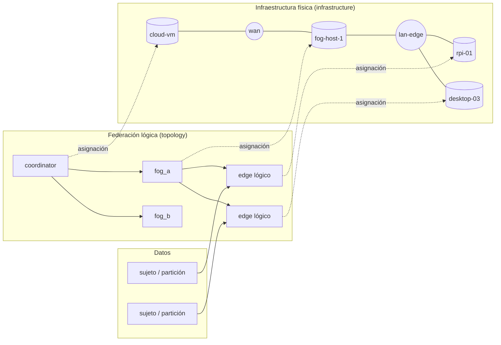

# Onion-FL infrastructure: experimentar con FL sobre el Computing Continuum

> Issue I1 (#185) del hito v0.8.0. Las issues I2–I17 (#186–#202) implementan esta spec; la tabla de la §16 da el número de cada una. La spec de capacidades `2026-11-04-onion-fl-capabilities.md` la complementa con la línea científica (A1–A9, #205–#213).

## 1. Objetivo

Que Onion-FL sea un entorno para **emular, desplegar y comparar aprendizaje federado sobre infraestructuras Edge–Fog–Cloud**, y no solo un emulador de clientes FL:

- definir de forma declarativa, por separado, **la federación** (quién agrega a quién), **los datos** (qué cliente lógico tiene qué partición) y **la infraestructura física** (máquinas, recursos y red) sobre la que se ejecuta;
- ejecutar **el mismo experimento** con tres backends (simulación, emulación local y despliegue distribuido) y con **la misma lógica de aprendizaje y agregación** en los tres;
- **medir la fidelidad** de cada backend frente al siguiente (funcional, de rendimiento y de decisión), desde v0.8.0;
- mantener un **núcleo de infraestructura** que evolucione con independencia del motor FL.

**Las dos preguntas de investigación** que esta spec debe permitir responder con resultados confirmados:
1. **Fidelidad de la emulación:** ¿anticipa un entorno local, con recursos y redes emulados, el comportamiento de una infraestructura Edge–Fog–Cloud física? ¿Qué decisiones se transfieren?
   - **No es una pregunta abierta en general.** En FL síncrono con servidor central ya está publicado que un modelo analítico rondas × tiempo por ronda conserva el ranking de configuraciones frente al despliegue (τ = 0,93/0,91), mejor que la simulación (0,61 en FLAIR) (Valli et al., CCGrid 2026, 10.1109/CCGRID68966.2026.00052). También está publicado que un simulador acierta el tiempo total de un entrenamiento de épocas fijas con un error < 2 %, sobre máquinas HPC con límites inyectados (FedDES, ACM SEC 2025, 10.1145/3769102.3770613).
   - **Nuestra novedad se acota a:** la jerarquía Edge–Fog–Cloud (agregación en fog), los regímenes con deadline o asincronía (que Valli deja como trabajo futuro) y la validación frente a dispositivos edge reales, no frente a máquinas HPC limitadas.
2. **Influencia del continuum sobre el aprendizaje:** ¿cómo interactúan la ubicación de los agregadores, las capacidades de los nodos, la red y la heterogeneidad natural de los datos con los algoritmos federados?

**El aprendizaje federado es el primer caso de uso y la validación científica.** El núcleo de infraestructura no depende de él (§6), pero esta spec no diseña otras cargas de trabajo.

## 2. Punto de partida

| Pieza | Hoy | Qué falta |
|---|---|---|
| Federación lógica | `topologies/*.yaml`: árbol con niveles arbitrarios (mínimo `global` y `edge`), agregador, quórum y plazo por nodo, `topology_id` | Nada en la federación; sí separar de ella lo físico que hoy lleva dentro (perfiles de enlace y de dispositivo) |
| Clientes | Un cliente por sujeto de entrenamiento (`subjects_per_client`), colocados bajo hojas por `placement` | Separar cliente lógico, partición de datos y nodo físico (§4) |
| Red | Perfil por enlace lógico o por nivel: latencia (fija, normal, lognormal), jitter, ancho de banda, pérdidas; presets `lan`, `wifi`, `4g`, `lora` | Red física con sitios y caminos; ubicación del broker; red que cambia con el tiempo |
| Cómputo | `samples_per_second` por edge, o tiempo medido | Perfiles con nombre; coste de agregar en fog y cloud (hoy es cero); contención cuando varios nodos lógicos comparten máquina; memoria |
| Disponibilidad | `always`, `bernoulli`, `schedule`, `crash_at` por nodo | Fallos de enlace y de máquina; reasignación de edges (*failover*) |
| Backends | `SimRuntime` (reloj virtual) y `RealRuntime` (reloj de pared, MQTT, un proceso por grupo en una máquina) | Emulación con límites de recursos y red emulada; despliegue en varias máquinas; contrato común de backend |
| Fidelidad | `test_runtime_equivalence`: simulación, real en proceso y MQTT multiproceso dan el mismo modelo final | Métricas de rendimiento y de decisión; experimentos de fidelidad; calibración |

## 3. Decisiones

| Tema | Decisión | Por qué |
|---|---|---|
| Nombre | La infraestructura física es la clave `infrastructure:`. `continuum:` sigue siendo continual learning, compatible, y migra más tarde a `continual:` (§14) | Evita un cambio incompatible inmediato y el choque de nombres |
| Capas del modelo | Cuatro conceptos separados: federación lógica, cliente lógico con su partición, infraestructura física y asignación de lo lógico a lo físico (§4) | Cambiar la máquina de un fog o el perfil de los edges no debe tocar ni la federación ni los datos |
| Clientes | Por defecto, un cliente lógico por sujeto (lo de hoy); la asignación a dispositivos y perfiles es una estrategia enchufable y reproducible, con su propia semilla | Conserva la heterogeneidad natural de los datos y permite estudiar la de los dispositivos aparte |
| Una sola fuente de verdad | Con `infrastructure`, los perfiles de red y de cómputo salen de ella; poner también `profile` o `device` en la topología se rechaza. Sin `infrastructure`, la topología actual define una infraestructura implícita y nada cambia | Ninguna ambigüedad, y los `topology_id`/`config_id` existentes se conservan |
| Misma lógica | Los roles (`Coordinator`, `Aggregator`, `Edge`), los entrenadores y los agregadores son los mismos objetos en los tres backends. Un backend solo da reloj, transporte, recursos y fallos | La fidelidad mide la infraestructura, no dos implementaciones distintas del algoritmo |
| Núcleo independiente | `onion_fl.infrastructure` no importa `learning`, `roles` ni `experiment`; un test de fronteras de import lo vigila (§6) | El núcleo puede evolucionar, o separarse, sin arrastrar el motor FL |
| Emulador | Containernet y Docker Compose + netem se evalúan en un spike con criterios fijados de antemano (§11, I9); la decisión queda registrada antes de I10 | Que cada enlace y cada recurso se emulen de verdad por separado es requisito, no supuesto |
| Fidelidad | Tres niveles (funcional, rendimiento, decisión), medidos desde v0.8.0 entre simulación y el backend `local` (§12) | Lo que no se mide pronto se diseña mal |
| Decisión | τ de Kendall (τ-b, con empates), acuerdo top-1, *selection regret* e intervalos de confianza por bootstrap emparejado por semilla | Un ranking parecido no basta si el ganador cambia o si equivocarse cuesta mucho |
| Calibración | La calibración (medir perfiles) y la validación (comprobar la fidelidad) son experimentos separados, con artefactos firmados distintos (§13) | Es la regla validación/test aplicada a la infraestructura: no se valida con lo que se ajustó |
| Transporte | gRPC como segundo transporte; MQTT se mantiene; Flower, adaptador opcional posterior que no bloquea nada | La visión no necesita Flower, y no debe controlar el bucle de rondas |
| Continual learning | C7 se recorta a lo que C8 necesita, sin rebajar la seguridad de promoción y rollback; el resto pasa a C7b (§14) | La infraestructura es la prioridad del producto |

## 4. Modelo conceptual



- **Federación lógica.** El árbol de roles FL de hoy: coordinador, agregadores y edges, con sus políticas. No sabe nada de máquinas.
- **Cliente lógico y partición.** Un edge lógico es un cliente FL; su partición de datos son las filas que le da `data` (un sujeto por defecto). Ambos son independientes de dónde se ejecute.
- **Infraestructura física.** Máquinas (*hosts*) con un perfil de recursos, agrupadas en sitios, y la red física entre sitios. También aloja los servicios que no son roles FL, como el broker MQTT.
- **Asignación.** Una función reproducible de lo lógico a lo físico: cada nodo lógico va a un host, y varios pueden compartir host. La latencia de un enlace lógico es la del **camino físico** entre sus dos hosts, pasando por el broker si el transporte lo usa.

**Consecuencias:**
- Mover un fog de máquina, cambiar la mezcla de dispositivos o pasar de MQTT a gRPC cambia la asignación o la infraestructura, nunca la federación ni los datos.
- Los escenarios A–D de la visión son la misma federación lógica (o la misma partición con otra federación) sobre otra infraestructura o asignación.
- Con MQTT, un mensaje edge → fog viaja edge → broker → fog. La simulación de hoy lo modela como un enlace directo; con infraestructura, el camino incluye el broker y la fidelidad lo puede medir.

## 5. Configuración

Interfaz propuesta (los valores numéricos son ilustrativos; los reales salen de la calibración, §13):

```yaml
# infrastructures/edge_fog_cloud_lab.yaml: solo lo físico
name: edge_fog_cloud_lab
profiles:
  cloud_vm:      {cpus: 8, memory: 16GB, train_rate: 20000, aggregate_rate: 5.0e8}
  fog_small:     {cpus: 4, memory: 4GB,  train_rate: 4000,  aggregate_rate: 1.0e8}
  raspberry_pi:  {cpus: 4, memory: 4GB,  train_rate: 900}
  desktop:       {cpus: 8, memory: 16GB, train_rate: 6000}
  low_power_iot: {cpus: 1, memory: 512MB, train_rate: 150}
sites:
  dc:    {hosts: {cloud-1: cloud_vm}}
  fog_1: {hosts: {fog-1: fog_small}}
  fog_2: {hosts: {fog-2: fog_small}}
  field: {pool: {raspberry_pi: 20, desktop: 10, low_power_iot: 10}}   # dispositivos de edge
network:
  links:
    - {between: [field, fog_1], latency: 10ms, bandwidth: 100Mbps, loss: 0.0}
    - {between: [field, fog_2], latency: 15ms, bandwidth: 50Mbps}
    - {between: [fog_1, dc], latency: 70ms, bandwidth: 10Mbps}
    - {between: [fog_2, dc], latency: 70ms, bandwidth: 10Mbps}
  schedule: []          # cambios con el tiempo (§8), vacío: red estática
services:
  mqtt_broker: cloud-1  # dónde vive el broker, si el transporte lo usa
```

```yaml
# en el experimento: qué infraestructura y cómo se asigna lo lógico
topology: four_fogs_swell_wesad          # federación lógica, sin perfiles físicos
infrastructure:
  name: edge_fog_cloud_lab
  assignment:
    root: cloud-1
    aggregators: {fog_a1: fog-1, fog_a2: fog-1, fog_b1: fog-2, fog_b2: fog-2}
    edges: {name: profile_mix, mix: {raspberry_pi: 0.5, desktop: 0.3, low_power_iot: 0.2}}
backend: sim                              # sim · local · emulated · distributed
```

- **Ficheros.** Las infraestructuras viven en `infrastructures/`, como las topologías, y se pueden barrer (`sweep: {infrastructure.name: [...]}`, `sweep: {infrastructure.assignment.edges: [...]}`).
- **Estrategias de asignación de edges** (registro `assignments`): `one_per_device` (cada edge lógico a un dispositivo distinto del *pool*, en orden sembrado), `profile_mix` (fracciones sembradas por perfil), `by_dataset` (p. ej. WESAD a `low_power_iot`), `explicit` y `colocated` (varios edges lógicos por host, para estudiar la contención). La semilla de la asignación es propia, como la de los roles, así que cambiarla no cambia los datos.
- **Identidad.**
  - `infrastructure_id` = SHA-256 de la infraestructura canónica (perfiles, sitios, red, servicios). La asignación entra en el `config_id`.
  - Sin `infrastructure`, los ids actuales no cambian: la topología define la infraestructura implícita (un host por nodo lógico y un enlace por enlace lógico, con su perfil).
  - `run.json` registra `backend` e `infrastructure_id`; un resultado cita los cinco: `topology_id`, `infrastructure_id`, `config_id`, `run_id`, `run_hash`.
- **`plan`** muestra la asignación resuelta: qué nodo lógico va a qué host, el camino físico y el perfil efectivo de cada enlace lógico, y la carga de cada host.
- **Validación previa** (en `plan`, antes de ejecutar): un host sin memoria para el modelo y sus datos; un enlace lógico sin camino físico; un pool con menos dispositivos que edges para `one_per_device`; un backend que no soporta algo que la infraestructura pide (§10).

## 6. Núcleo de infraestructura y extensibilidad

- **Paquete `onion_fl.infrastructure`**, que solo depende de `core`:
  - `model`: `Profile`, `Host`, `Site`, `Network`, `Link`, `Service`, `Infrastructure`, con `infrastructure_id`;
  - `paths`: el camino físico entre dos hosts y su perfil efectivo (latencia sumada, ancho de banda mínimo, pérdida 1 − ∏(1 − pᵢ));
  - `assignment`: el registro `assignments` y la asignación resuelta;
  - `backends`: el registro `backends` y su contrato (§10);
  - `emulators`: los generadores del backend emulado (§11).
- **Interfaz estrecha hacia el motor FL.** El motor FL ve, por nodo lógico, un **modelo de recursos** (cuánto tarda un trabajo de entrenamiento o de agregación, cuánta memoria hay, cuándo está caído) y, por enlace lógico, un **modelo de enlace** (lo que `SimRuntime` ya consume). Los compiladores del núcleo producen esos modelos desde la infraestructura y la asignación; `SimRuntime` y `RealRuntime` no saben de sitios ni de hosts.
- **Fronteras.** Un test recorre los imports de `onion_fl.infrastructure` y falla si alcanza `learning`, `roles`, `experiment` o `data`.
- **Puntos de extensión** (registros con parámetros pydantic, como el resto de ejes): perfiles, `assignments`, modelos de red (`static`, `schedule`, `trace`), `failovers`, `backends` y `emulators`. Un plugin nuevo es una clase decorada; el Studio y `onion_fl schema` los exportan.
- **Otras cargas de trabajo.** El núcleo trata los nodos como "trabajos con mensajes"; un sistema distribuido que no sea FL podría usarlo más adelante. Esta spec no lo diseña: solo prohíbe que el núcleo dependa del motor FL.

## 7. Recursos y cómputo

- **Perfiles.** Cada perfil da `train_rate` (muestras/s), `aggregate_rate` (bytes de actualización combinados por segundo), `cpus` y `memory`. Un perfil puede apuntar a una calibración (`calibration: <id>`) en vez de dar números.
- **`train_rate` por modelo.** Se calibra cada par (perfil, modelo) que se use (§13). Si un modelo no está calibrado en un perfil, se estima escalando la tasa de un modelo calibrado por la razón de sus FLOPs por muestra, y la ejecución queda marcada como `estimated` en `run.json`. Un resultado de fidelidad no puede apoyarse en tasas estimadas.
- **Coste de agregar.** Agregar en un fog o en el cloud ocupa su host durante bytes recibidos / `aggregate_rate`. Hoy cuesta cero; con infraestructura deja de hacerlo. Un fog sobrecargado cierra su ronda más tarde.
- **Contención.** Los trabajos de los nodos lógicos que comparten host compiten por sus `cpus`: hasta `cpus` trabajos a la vez y los demás en cola FIFO. Sin contención (un nodo por host), el resultado es el de hoy.
- **Memoria.** El tamaño del modelo y de los datos de un nodo se compara con la memoria de su host en `plan`; si no cabe, se rechaza. No se simula el *swapping*.
- **Fuera de alcance:** energía, temperatura, *throttling* y arquitectura del procesador. Que un perfil `raspberry_pi` limite CPU y memoria no reproduce un ARM; por eso los perfiles se calibran en el hardware real (§13).

## 8. Red física

- **Sitios y enlaces.** La red une sitios; dentro de un sitio, los hosts se ven por una red local con su propio perfil (por defecto `lan`). El enlace lógico A → B usa el camino físico entre `host(A)` y `host(B)`, más el broker cuando el transporte es MQTT.
- **Compartición** (`network.bandwidth: shared | dedicated`, por defecto `shared`).
  - `shared`: los enlaces lógicos que pasan por el mismo enlace físico comparten su ancho de banda (una cola por enlace físico). Es lo que ocurre en una WAN de fog a cloud.
  - `dedicated`: cada enlace lógico tiene el ancho de banda completo de su camino, como hoy. Sirve de control y para aislar el efecto de la compartición.
  - En la infraestructura implícita (un enlace físico por enlace lógico) los dos modos dan lo mismo, así que los ids y resultados actuales no cambian.
- **Red dinámica** (`network.schedule`): cambios de latencia, ancho de banda y pérdidas a partir de un instante, y caídas de enlace con su vuelta, en tiempo de experimento. Con un modelo `trace` se reproduce una traza medida.
- **Ubicación de servicios.** El broker MQTT es un host de la infraestructura; su caída corta todos los enlaces que pasan por él.

## 9. Continuum dinámico

- **Fallos.** Caen hosts (con todos sus nodos lógicos) y enlaces (§8), además de la disponibilidad por nodo de hoy.
- **Reasignación (`failover`).** Un edge cuyo fog no responde en `after` (tiempo) se reasigna según una política (`none` por defecto, `nearest_alive`, `explicit`). El edge saluda a su nuevo padre y entra en la ronda siguiente; recibe los grupos de zona de su nuevo fog. Sus datos no se mueven: la partición es del cliente lógico.
- **Movilidad (posterior, fuera de v0.8.0).** Se modelará como un host que cambia de sitio en un instante dado (`network.schedule`), con reasignación por la misma política. El escenario D de v0.8.0 se cubre con fallos, sobrecarga y `failover`.
- **Sobrecarga.** Un fog con cola de agregación por encima de un umbral puede rechazar edges nuevos (`max_children`), y la política los envía a otro.
- **Eventos.** `host.down`, `host.up`, `link.down`, `link.up`, `link.changed` y `edge.reparented`. Los cambios dinámicos son eventos, no identidad: `topology_id` e `infrastructure_id` describen el estado inicial.
- **Reglas de protocolo que hay que fijar en I6:** qué pasa con la actualización en vuelo de un edge reasignado (se descarta como tardía de su antiguo padre); cómo cuenta el quórum de un fog que pierde hijos (sobre los vivos); que un edge no cambie de zona a mitad de ronda.

## 10. Backends

| Backend | Reloj | Recursos y red | Dónde | Para qué |
|---|---|---|---|---|
| `sim` | Virtual | Modelados (§7–§8) | Un proceso | Barridos rápidos y reproducibles |
| `local` | Pared | Los de la máquina, sin límites ni red emulada | Un proceso por grupo en una máquina (lo de hoy con `--mode real`) | Fidelidad funcional; referencia sin emulación |
| `emulated` | Pared | Límites de CPU y memoria por host, red emulada por enlace (§11) | Contenedores en una máquina o una VM Linux | Fidelidad de rendimiento sin hardware |
| `distributed` | Pared | Los reales | Hosts reales (I14): Raspberry Pi (edge), el PC de desarrollo (Windows 11 + WSL2) y un servidor Linux (fog y cloud); dos móviles, opcionales (§15) | La referencia física |

- **Contrato de backend:** `prepare(scenario, infrastructure, assignment)` devuelve un plan de ejecución; `run(plan)` lo ejecuta; `collect(plan)` devuelve los eventos fusionados y la ejecución firmada, como hace hoy el lanzador real. `supports(infrastructure)` dice qué puede reproducir, y `plan` rechaza lo que no.
- **Misma lógica.** Los cuatro construyen la federación con `build_federation` y los mismos `EdgeSpec`; ningún backend reimplementa roles, entrenadores ni agregadores. `test_runtime_equivalence` se extiende a cada backend nuevo: con quórum completo, sin pérdidas y la misma semilla, el modelo final es el mismo bit a bit.
- **Equivalencias que se vigilan:** los bytes por enlace lógico deben ser idénticos en todos los backends (mismo codec); el número de rondas y su cierre, idénticos cuando el protocolo no depende del tiempo.
- **`--mode real` sigue funcionando** como alias de `backend: local` hasta la migración.

## 11. Emulación: Containernet frente a Docker Compose + netem

El requisito: **cada enlace y cada recurso se emulan por separado y de verdad** (un enlace fog–cloud de 10 Mbps no frena el tráfico edge–fog, y el límite de CPU de un host no afecta a otro).

| Criterio | Docker Compose + netem | Containernet |
|---|---|---|
| Qué es | Un contenedor por host lógico; `tc netem`/`tbf` en sus interfaces | Fork de Mininet que usa contenedores Docker como hosts; enlaces `TCLink` (tc) entre ellos |
| Red por enlace | `tc` actúa por interfaz y en salida: por destino necesita una red Docker por enlace o filtros `tc` por IP; la entrada necesita IFB. A verificar | Un par de interfaces por enlace, con su ancho de banda, retardo y pérdidas. A verificar |
| Recursos por host | `cpus`, `mem_limit` de Docker | Límites de Docker por host (cuota de CPU, memoria). A verificar |
| Topologías con varios saltos | Rutas manuales entre redes | Nativas (conmutadores OVS) |
| Requisitos | Docker con `NET_ADMIN`; el kernel debe tener `sch_netem`. En Docker Desktop sobre WSL2 (nuestra máquina) está por comprobar | Linux con Open vSwitch y root; en Windows, una VM Linux. A comprobar en WSL2 |
| Mantenimiento y reproducibilidad | Docker estándar | Proyecto académico; versión a fijar |
| Antecedentes | Fogify usa Docker + tc | Usado en investigación de NFV y fog |

**El spike I9 decide con datos, no con esta tabla:**
- prototipo de los dos sobre la misma infraestructura de 1 cloud, 2 fogs y 4 edges;
- medir, por enlace, la latencia (RTT), el ancho de banda y las pérdidas aplicados frente a los pedidos, con y sin tráfico cruzado en otros enlaces; y por host, el rendimiento de entrenamiento con distintos límites de CPU;
- criterios de aceptación fijados antes de medir: error de latencia ≤ 10 % o 1 ms, de ancho de banda ≤ 10 %, de pérdidas ≤ 1 punto, aislamiento entre enlaces (el tráfico cruzado no cambia otro enlace más que ese error), y que arranque en la máquina de desarrollo o en una VM documentada;
- resultado: un registro de decisión commiteado (`docs/decisions/`), con las medidas. I10 implementa el elegido; el otro queda como plugin de `emulators` posible.

## 12. Fidelidad

Fidelidad de un backend B (más barato) frente a uno A (más cercano a lo físico) sobre el mismo experimento:

| Nivel | Qué se compara | Métrica |
|---|---|---|
| Funcional | Que cada nodo hace su papel | Modelo final bit a bit (en condiciones deterministas); secuencia de eventos de protocolo por nodo (rondas abiertas, cerradas, fallidas, ociosas); bytes por enlace lógico |
| Rendimiento | Que tiempos y recursos son representativos | Error relativo de la duración de cada ronda, del tiempo hasta una precisión dada, del tiempo de cómputo por nodo y de la latencia por enlace; con IC |
| Decisión | Que el mejor diseño en B también lo es en A | Sobre K configuraciones (algoritmos, topologías, asignaciones): τ-b de Kendall entre los rankings; acuerdo top-1; *selection regret* = puntuación en A del ganador de B − mejor puntuación en A (en unidades de la métrica y relativo); IC por bootstrap emparejado por semilla, y probabilidad bootstrap de acuerdo top-1 |

- **Requisitos previos de cualquier métrica de decisión** (de la spec de capacidades):
  - **Techo de ruido.** Un regret o un desacuerdo top-1 solo cuenta si supera el que hay entre réplicas de la misma configuración (otras semillas y, si hay búsqueda de hiperparámetros, otra búsqueda). El arnés lo calcula y lo muestra al lado.
  - **Predictor factorizado.** Rondas hasta objetivo × tiempo por ronda (Luo 2021, Valli 2026) es un comparador obligatorio: si un backend no decide mejor que ese modelo analítico, no aporta.
- **Métricas sobre las que decidir.** Las de aprendizaje (macro-F1 final y prequential) y las de sistema (tiempo de ronda, tiempo hasta precisión, bytes). Lección de C3–C5: si todas las configuraciones acaban en un predictor constante, la fidelidad de decisión sobre el aprendizaje no informa; el experimento debe comprobarlo y decirlo, y decidir también sobre métricas de sistema.
- **Estadística.** Al menos 5 semillas para la fidelidad de decisión (decidido en la revisión; 3 dejan los IC demasiado anchos). Los IC se calculan con bootstrap emparejado por semilla y configuración.
- **Desde v0.8.0.** El arnés (`onion_fl fidelity A B`) y las métricas llegan en v0.8.0 (I7), y se aplican entre `sim` y `local`: la fidelidad funcional ya se cumple, y la de rendimiento muestra cuánto se aleja el reloj virtual del de pared sin emulación. Cada backend nuevo (I10, I14) entra con su comparación de fidelidad en su propia issue.
- **Autocomprobaciones de la simulación.** Tests analíticos: con un solo mensaje, el tiempo de llegada es latencia + tamaño / ancho de banda; con contención, el orden FIFO; con un enlace físico compartido, el reparto.

## 13. Calibración y validación

- **Calibración** (I12): microbenchmarks en el backend objetivo, nunca experimentos FL de validación.
  - Rendimiento de entrenamiento por par (perfil, modelo), rendimiento de agregación, y RTT, ancho de banda y pérdidas de cada enlace medidos con el propio transporte.
  - Produce un artefacto firmado en `calibrations/<calibration_id>/` (medidas, entorno, versión del código), del que salen los parámetros de los perfiles.
- **Validación** (I13, I15): experimentos FL que comparan backends con una calibración ya cerrada y citada.
  - Usan cargas distintas de las de calibración (otra topología, otro modelo u otro dataset).
  - Cambiar los perfiles después de ver una validación exige una calibración nueva y declararlo en el INDEX, como en la regla de C6.
- **Regla de `docs/RULES.md` (§3):** no se valida la fidelidad con los mismos datos y configuraciones con los que se calibró.

## 14. Continual learning en este plan

- **C7 recortado (#162).** Se queda:
  - champion y challenger, y `PromotionPolicy` configurable con su comprobación de retención (`max_forgetting`) y `min_samples`;
  - los edges sirven el champion y el challenger no llega a producción antes de promoverse;
  - eventos de promoción, rechazo y rollback;
  - aceptación: un challenger que mejora lo reciente pero olvida más de `max_forgetting` se rechaza, y un rollback restaura el champion anterior con su estado (tests).
- **C7b (posterior).** Vista de versiones y controles del Studio (programar, pausar, promover, revertir), API externa y series de Prometheus por versión.
- **C8 (#163)** sigue igual y depende del C7 recortado.
- **Migración `continuum:` → `continual:` (M1, posterior).** Los disparadores pasan a `continual.trigger`, `continual.edge_trigger` y `continual.status_every`, junto a la memoria que ya vive en `continual:`. Durante una versión se aceptan las dos formas, con un aviso de obsolescencia, y el `config_id` de una config antigua no cambia. El paquete `onion_fl.continuum` pasa a `onion_fl.continual` con un alias.

## 15. Riesgos y fuera de alcance

- **Entorno.** La máquina de desarrollo es Windows + WSL2; la emulación puede necesitar una VM Linux (§11). Se documenta en I9.
- **Hardware real.** Las Raspberry Pi son ARM64: hace falta comprobar que PyTorch y las dependencias se instalan en ellas, y su `train_rate` real puede dejar las ejecuciones largas. El PC de desarrollo participa vía WSL2 o Docker. Los móviles son opcionales: un spike (I14) decide si un nodo Python corre en Android (por ejemplo con Termux) o si se quedan fuera; iOS queda fuera.
- **Netem a escala pequeña.** Latencias de pocos milisegundos y anchos de banda altos pueden quedar por debajo de la precisión de `tc`; el spike mide dónde.
- **Escala.** Decenas de contenedores en una máquina son razonables; cientos, no. El backend emulado declara su tope y `plan` lo comprueba.
- **Fuera de alcance:** energía, movilidad física, radio (más allá de perfiles de enlace), seguridad de la red emulada, y cargas que no sean FL.

## 16. Qué implementa cada issue

**Orden:** I1 → I2 → (I3, I4, I5 en paralelo) → I6 → I7 → I8 (v0.8.0); I9 → I10, I11, I12 → I13 (v0.9.0); I14 → I15 y C9 (v0.10.0); I16, I17 (v1.0.0). C7 recortado y C8 cierran v0.7.0 en paralelo a v0.8.0.

**Línea científica (spec de capacidades, A1–A9, #205–#213):** avanza en paralelo a v0.8.0 y no espera a los backends `emulated` ni `distributed`. Solo depende de I3 (A1, la asignación con acoplamiento) y de I7 (A7 y A8, el predictor y el diagnóstico); A2–A6 pueden empezar ya.

| Issue | Secciones |
|---|---|
| I1 (#185) Spec | toda |
| I2 (#186) Núcleo de infraestructura | §5 (ficheros, identidad), §6 |
| I3 (#187) Asignación lógico → físico | §4, §5 (asignación) |
| I4 (#188) Recursos y cómputo | §7 |
| I5 (#189) Red física | §8 |
| I6 (#190) Continuum dinámico | §9 |
| I7 (#191) Arnés de fidelidad | §10 (contrato), §12 |
| I8 (#192) Arquitecturas A–D | §1 (pregunta 2), §12 |
| M1 (#193) Migración a `continual:` | §14 |
| I9 (#194) Spike del emulador | §11 |
| I10 (#195) Backend emulado | §10, §11 |
| I11 (#196) gRPC | §3 (transporte), §10 |
| I12 (#197) Calibración | §13 |
| I13 (#198) Fidelidad sim–emulado | §12, §13 |
| I14 (#199) Backend distribuido | §10 |
| I15 (#200) Fidelidad frente a lo físico | §12, §13 |
| I16 (#201) Benchmark de fidelidad e influencia del continuum | §1, §12 |
| I17 (#202) Comparativa con otros frameworks | §1 |
| C7b (#203), Flower FL1 (#204) | §14, §3 |

## 17. Decisiones de la revisión

| Pregunta | Decisión |
|---|---|
| ¿Ancho de banda compartido o dedicado? | Los dos: `network.bandwidth: shared` (por defecto) o `dedicated` (§8) |
| ¿Coste del modelo por FLOPs o calibrado? | Calibrado por par (perfil, modelo); escalado por FLOPs solo como estimación marcada `estimated`, que no vale para resultados de fidelidad (§7) |
| ¿Qué hardware real hay? | Raspberry Pi, el PC de desarrollo, un servidor Linux y, opcionalmente, dos móviles (§10, §15) |
| ¿5 semillas como mínimo? | Sí, para la fidelidad de decisión (§12) |
| ¿Escenario D? | Fallos, sobrecarga y `failover` en v0.8.0; la movilidad, más adelante, como cambio de sitio de un host (§9) |

Además, de la spec de capacidades:
- **Pregunta 1 acotada** con Valli y FedDES (§1).
- **Techo de ruido y predictor factorizado** como requisitos de toda métrica de decisión (§12).
- **La línea científica avanza en paralelo** a v0.8.0 (§16).
